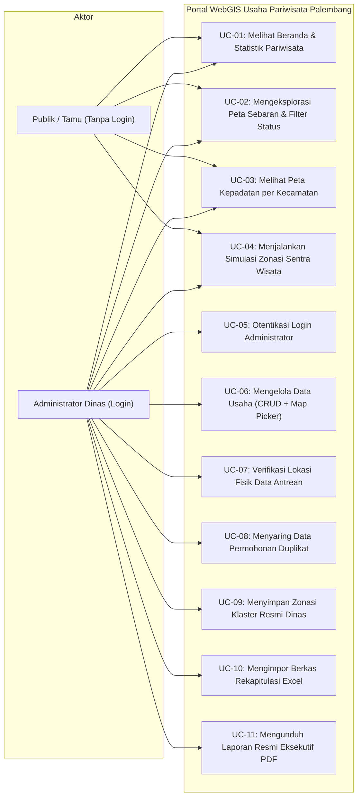
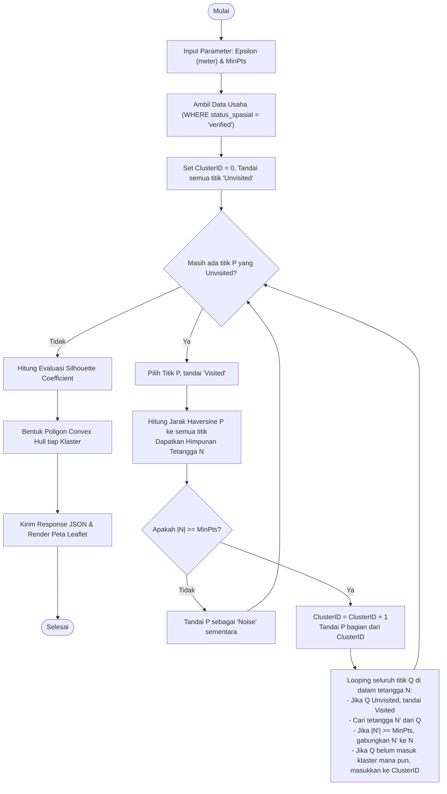

# PRODUCT REQUIREMENT DOCUMENT (PRD)
## SISTEM INFORMASI GEOGRAFIS BERBASIS WEB UNTUK PEMETAAN DAN KLASTERISASI USAHA PARIWISATA KOTA PALEMBANG MENGGUNAKAN ALGORITMA DBSCAN

* **Dokumen:** Product Requirement Document (PRD) Komprehensif  
* **Program Studi:** Sarjana Terapan (D4) Manajemen Informatika  
* **Jurusan:** Manajemen Informatika, Politeknik Negeri Sriwijaya (Polsri)  
* **Status Dokumen:** Baseline Resmi & Terkunci (Kitab Suci Proyek)  
* **Terakhir Diperbarui:** 23 Oktober 2026  

---

## DAFTAR ISI
1. [Problem Statement & Product Objectives](#1-problem-statement--product-objectives)
2. [User Roles, Privacy Governance, & Access Control Matrix](#2-user-roles-privacy-governance--access-control-matrix)
3. [Pemodelan Kebutuhan Pengguna (Use Case Modeling & Scenarios)](#3-pemodelan-kebutuhan-pengguna-use-case-modeling--scenarios)
4. [Kebutuhan Fungsional Sistem & Kamus Data (5 Modul Utama)](#4-kebutuhan-fungsional-sistem--kamus-data-5-modul-utama)
5. [Formulasi Matematis & Alur Algoritma DBSCAN](#5-formulasi-matematis--alur-algoritma-dbscan)
6. [Kebutuhan Non-Fungsional, Arsitektur Teknis, & Edge Cases](#6-kebutuhan-non-fungsional-arsitektur-teknis--edge-cases)
7. [Matriks Pengujian Sistem (Black Box Testing & Algorithmic Validation)](#7-matriks-pengujian-sistem-black-box-testing--algorithmic-validation)
8. [Roadmap Keberlanjutan ke Skripsi D4 Polsri](#8-roadmap-keberlanjutan-ke-skripsi-d4-polsri)

---

## 1. PROBLEM STATEMENT & PRODUCT OBJECTIVES

### 1.1 Konteks Regulasi & Latar Belakang Operasional
Berdasarkan **Peraturan Pemerintah (PP) No. 5 Tahun 2021 tentang Penyelenggaraan Perizinan Berusaha Berbasis Risiko**, seluruh perizinan berusaha di Indonesia dialihkan secara terpusat melalui sistem **Online Single Submission Risk-Based Approach (OSS-RBA)** yang didelegasikan di daerah melalui **Dinas Penanaman Modal dan Pelayanan Terpadu Satu Pintu (DPMPTSP)**.

Dampaknya terhadap tata kelola pemerintahan Kota Palembang:
* **Dinas Pariwisata Kota Palembang** tidak lagi memiliki wewenang menerbitkan izin usaha pariwisata secara mandiri, melainkan bertransformasi menjadi **instansi pembina dan pengawas teknis lapangan (*monitoring, evaluasi, dan post-audit*)**.
* Untuk melaksanakan fungsi monitoring berkala, Dinas Pariwisata diberikan hak akses akun pemantauan ke sistem OSS dan secara periodik menerima berkas rekapitulasi perizinan dari DPMPTSP dalam format tabular Excel (`Data Pariwisata.xlsx`).
* Namun, format data tabular tersebut tidak memadai untuk mendukung tugas operasional dinas dalam melakukan pemantauan faktual, pengendalian tata ruang wisata, maupun analisis potensi aglomerasi ekonomi pariwisata daerah.

---

### 1.2 Masalah Nyata di Lapangan (Problem Statement)
Berdasarkan hasil audit mendalam terhadap berkas perizinan `Data Pariwisata.xlsx` (total 2.809 baris data mentah), ditemukan 5 kendala utama:

1. **Cacat Geospasial Hulu (Ketiadaan Atribut Koordinat di OSS):**
   * Formulir pendaftaran OSS dari pemerintah pusat tidak mewajibkan pemohon izin mengisi titik koordinat geospasial (*Latitude* dan *Longitude*).
   * Akibatnya, seluruh 2.809 data yang diterima Dinas Pariwisata tidak memiliki informasi spasial, sehingga dinas mengalami "kebutaan geospasial" mengenai letak fisik tempat usaha di dunia nyata.
2. **Kualitas Data Teks Sangat Rendah dan Anomali (*Dirty Data*):**
   * Pendaftaran mandiri (*self-declaration*) oleh pelaku usaha memicu inkonsistensi input yang parah. Kolom nama proyek usaha bercampur antara nama badan hukum (PT/CV), nama pemilik pribadi, nama jalan, singkatan tidak baku, hingga karakter/simbol khusus.
   * **Masalah Nama Generik:** Banyak usaha yang didaftarkan hanya menggunakan nama generik kategorinya (contoh riil di Excel: usaha hotel bintang dinamai cuma *"Hotel Bintang"*, resto dinamai cuma *"Restoran"*, penginapan dinamai cuma *"Penginapan remaja"*), sehingga mempersulit verifikasi fisik bangunan di lapangan.
3. **Alamat Tidak Terstandarisasi untuk Pelacakan Digital:**
   * Sebagian besar alamat hanya mencantumkan nama jalan protokol tanpa nomor bangunan, atau sebaliknya hanya mencantumkan nomor RT/RW dan nama lorong sempit tanpa nama jalan utama. Kondisi ini membuat alamat gagal dilacak secara otomatis oleh mesin peta (Google Maps / OpenStreetMap).
4. **Akumulasi Riwayat Perizinan Ganda (Duplikasi Historis):**
   * DPMPTSP tidak berwenang menghapus riwayat pendaftaran izin lama kecuali atas permohonan pencabutan resmi dari pelaku usaha.
   * Akibatnya, terjadi penggembungan data semu di mana satu lokasi fisik yang sama terdaftar berulang kali di tanggal berbeda akibat pengajuan izin baru, perubahan modal, atau pergantian nama proyek.
5. **Keterbatasan Analisis Tabular terhadap Kerapatan Lapangan:**
   * Informasi rekapitulasi dinas selama ini hanya mampu menjumlahkan angka secara administratif per kecamatan. Format tabel ini **gagal memperlihatkan titik kumpul kerapatan riil di lapangan**: koridor jalan mana yang mengalami kejenuhan usaha pariwisata, dan area mana yang kekurangan fasilitas pendukung (*underserved*).

---

### 1.3 Ruang Lingkup Data & Strategi Status Ganda Spasial + Tri-State Operasional
Sistem **tidak membuang** data dinas yang belum lengkap, melainkan menerapkan mekanisme klasifikasi bertingkat:
* **Total Basis Data:** **2.809 baris data usaha perizinan dinas** disimpan ke dalam sistem database MySQL.
* **Status Spasial Verified (1.421 data):** Data yang telah tervalidasi memiliki titik koordinat presisi di dalam batas Kota Palembang.
* **Status Spasial Unverified (1.388 data):** Data yang koordinatnya masih kosong tetap tersimpan rapi di database internal sebagai antrean verifikasi untuk dilengkapi secara berkala oleh staf dinas.
* **Klasifikasi Faktual Operasional (Validasi Google Maps pada 1.421 Titik Terverifikasi):**
  1. **`Buka` (Aktif Beroperasi):** **1.281 usaha (90,15%)** — Merupakan entitas bisnis yang aktif dan menjadi **fokus utama komputasi klasterisasi DBSCAN** agar klaster yang terbentuk benar-benar mencerminkan sentra ekonomi riil yang hidup (*active economic agglomeration*).
  2. **`Tutup Permanen` (Bangkrut / Gulung Tikar):** **109 usaha (7,67%)** — Usaha yang gedungnya sudah tutup permanen. Usaha ini dipisahkan dari klasterisasi utama agar tidak memicu terbentuknya **klaster semu (*phantom clusters*)**.
  3. **`Tutup Sementara` (Renovasi / Musiman):** **31 usaha (2,18%)** — Usaha yang sedang berhenti sementara.

#### Rincian Data Terverifikasi per Kategori KBLI & Status Operasional:
| Kode KBLI | Kategori Usaha | Buka (Aktif) | Tutup Permanen | Tutup Sementara | Total Titik Terverifikasi |
| :---: | :--- | :---: | :---: | :---: | :---: |
| 55110 | Hotel Bintang | 60 | 0 | 0 | 60 |
| 55120 | Hotel Melati | 34 | 1 | 0 | 35 |
| 55191 | Penginapan Remaja (Youth Hostel) | 19 | 0 | 1 | 20 |
| 56101 | Restoran | 627 | 66 | 16 | 709 |
| 56301 | Bar | 22 | 5 | 0 | 27 |
| 56303 | Rumah Minum/Kafe | 269 | 27 | 11 | 307 |
| 79121 | Aktivitas Biro Perjalanan Wisata | 106 | 5 | 2 | 113 |
| 79122 | Aktivitas Biro Perjalanan Ibadah Umroh | 104 | 2 | 1 | 107 |
| 93291 | Klub Malam | 2 | 0 | 0 | 2 |
| 93292 | Karaoke | 21 | 0 | 0 | 21 |
| 93293 | Usaha Arena Permainan | 17 | 3 | 0 | 20 |
| **TOTAL** | **Seluruh Usaha Pariwisata** | **1.281** | **109** | **31** | **1.421** |

---

### 1.4 Tujuan Produk (Product Objectives) & Arsitektur 3 Halaman Utama
Sistem Informasi Geografis Berbasis Web (WebGIS) ini dirancang dengan antarmuka portal modern yang **ramah pengguna (*user-friendly*)** dan membumi. Pengunjung masyarakat umum, calon investor, maupun pimpinan instansi tidak dibebani oleh istilah teknis matematika yang membingungkan (*intimidating technical jargon*). 

#### Prinsip Penamaan Antarmuka (User-Centric UI Terminology) vs. Mesin Algoritmik Backend:
Di antarmuka publik, sistem menggunakan bahasa Indonesia yang wajar dan intuitif, sedangkan di balik layar sistem tetap mengeksekusi algoritma data mining spasial ilmiah secara murni untuk keperluan pengujian sidang skripsi D4:

| Istilah Teknis Asli (Backend / Skripsi) | Penamaan di Tampilan Web (Bahasa Biasa & Ramah Pengguna) | Alasan Perubahan Bahasa |
| :--- | :--- | :--- |
| **Analisis Spasial DBSCAN** | **Sentra Pariwisata** (atau **Zonasi Sentra Wisata**) | Publik tidak tahu kepanjangan/makna DBSCAN. "Sentra Pariwisata" langsung menjelaskan manfaat nyata: melihat kawasan wisata yang mengelompok di Palembang. |
| **Choropleth Map** | **Kepadatan per Kecamatan** (Tab ke-2 di Peta Sebaran) | "Choropleth" adalah istilah kartografi asing. "Kepadatan per Kecamatan" langsung dipahami siapa saja dalam 1 detik. |
| **Katalog Titik Spasial** | **Sebaran Tempat Usaha** (Tab ke-1 di Peta Sebaran) | Lebih natural dan to the point untuk mencari lokasi hotel, resto, kafe, atau travel. |
| **Parameter Radius $\varepsilon$ (Epsilon)** | **Jarak Maksimal Antar Tempat (Meter)** | Pengguna awam tahu jarak dalam meter (misal: 300 meter), bukan simbol Yunani $\varepsilon$. *Subketerangan kecil tetap dicantumkan: (Radius pencarian / Epsilon).* |
| **Parameter Titik Minimum (*MinPts*)** | **Minimal Tempat Berkumpul** | Menjelaskan secara gamblang berapa titik usaha yang harus berdekatan agar diakui sebagai satu sentra/kawasan. |
| **Tombol Eksekusi DBSCAN** | **`[ Temukan Sentra Wisata ]`** | Lebih komunikatif dan berorientasi aksi daripada tombol kaku bertuliskan `[ Proses Klasterisasi ]`. |
| **Poligon Convex Hull** | **Area Batas Sentra** | Garis batas dan poligon warna transparan yang melingkupi tempat-tempat usaha dalam satu kelompok sentra. |
| **Titik Noise / Outlier** | **Usaha Tersebar (Di Luar Sentra)** | Menggantikan konotasi kata "Noise/Sampah" dengan istilah netral: usaha mandiri yang lokasinya berada di luar kawasan sentra. |
| **Silhouette Coefficient / Score** | **Tingkat Kerapihan Kawasan** (atau **Ketepatan Zonasi**) | Menampilkan status kualitatif yang jelas (*Sangat Rapi / Terpisah Baik / Tumpang Tindih*) disertai angka metrik ilmiah (0.58) untuk validasi sidang. |

---

#### Arsitektur Halaman Sistem (3 Halaman Publik + 2 Halaman Internal Admin):

##### A. Halaman Publik (Akses Terbuka / Tanpa Login):
1. **Halaman 1: Beranda & Statistik Pariwisata (`/`):**
   * Menyajikan ringkasan eksekutif makro perkembangan usaha pariwisata Kota Palembang secara visual dan komunikatif.
   * Menampilkan kartu ringkasan kondisi operasional (Buka, Tutup, Antrean), diagram peringkat kepadatan usaha di 18 kecamatan, serta diagram proporsi sektor pariwisata.
2. **Halaman 2: Peta Sebaran Usaha (`/peta`):**
   * Menyediakan eksplorasi spasial katalog usaha pariwisata dengan dua pilihan tab yang intuitif:
     * **Tab 1: Sebaran Tempat Usaha:** Menampilkan 1.421 pin sebaran tempat usaha lengkap dengan filter status operasional (`Buka`, `Tutup`), filter kategori KBLI, serta kotak pencarian nama tempat dengan efek otomatis mendekat (*auto-pan/zoom*).
     * **Tab 2: Kepadatan per Kecamatan:** Menampilkan visualisasi batas 18 wilayah kecamatan dengan gradasi warna kepadatan wilayah (berbasis `palembang.geojson`).
3. **Halaman 3: Sentra Pariwisata (`/zonasi`):**
   * Menemukan dan memetakan kawasan konsentrasi sentra pariwisata di Kota Palembang secara otomatis menggunakan algoritma spasial DBSCAN.
   * Menggunakan tata letak modern **Peta Penuh (*Full-Bleed Map*)** dengan **Panel Pengaturan Sentra (*Floating Workbench*)** yang fleksibel dan dapat dilipat/diminimalkan (`[_] [X]`).
   * Menampilkan poligon area pembungkus sentra kawasan (*Convex Hull*), memisahkan usaha mandiri di pinggiran sebagai titik tersebar (*noise*), menyajikan skor kerapihan kawasan (*Silhouette Score*).

##### B. Halaman Internal Administrator (Wajib Login):
4. **Halaman 4: Dashboard Eksekutif & Statistik Mutu Data (`/admin`):**
   * Khusus Pimpinan / Kepala Dinas & Penguji Sidang: Menyajikan 4 kartu metrik data izin, 3 grafik analitis mendalam (Mutu Geospasial, Ketahanan Usaha Buka vs Tutup Permanen, dan Tren Pengajuan Izin Tahunan OSS), serta tombol cepat cetak dokumen eksekutif PDF.
5. **Halaman 5: Kelola Data Usaha & Verifikasi Spasial (`/admin/usaha`):**
   * Khusus Staf Teknis / Operator Data Dinas: Meja kerja terpadu (*Single Integrated Workbench*) untuk pemeliharaan 2.809 data izin, verifikasi kilat data antrean, penambahan usaha manual lengkap dengan peta interaktif (*Map Picker*), dan modal impor berkas Excel DPMPTSP.
* **Fitur Penguncian Terintegrasi (Tanpa Menambah Halaman Baru):**
  * Di halaman **Sentra Pariwisata (`/zonasi`)**, saat sistem mendeteksi admin sedang login, otomatis muncul tombol eksklusif **`[ Kunci sebagai Sentra Resmi Dinas ]`** di panel *Floating Workbench*.

---

## 2. USER ROLES, PRIVACY GOVERNANCE, & ACCESS CONTROL MATRIX

### 2.1 Definisi Aktor Sistem
1. **Publik / Tamu (*Public Guest*):**
   * **Sifat Akses:** Tanpa Login (*Unauthenticated* / Akses Terbuka).
   * **Fungsi:** Masyarakat, calon investor, akademisi, dan dewan penguji sidang yang mengakses portal untuk melihat informasi sebaran usaha, peta kepadatan kecamatan, dan melakukan simulasi penemuan sentra wisata secara interaktif.
   * **Batasan:** Bersifat *stateless* (hanya baca). Simulasi parameter hanya berjalan di layar browser sendiri dan tidak dapat mengubah basis data dinas.
2. **Administrator (Staf Teknis & Pimpinan Dinas Pariwisata):**
   * **Sifat Akses:** Wajib Login (*Authenticated* via Email & Password terenkripsi).
   * **Fungsi:** Pengelola resmi data perizinan pariwisata Kota Palembang.
   * **Wewenang:** Memegang kendali penuh atas basis data (CRUD manual + Map Picker), verifikasi koordinat antrean, impor berkas DPMPTSP, penetapan sentra resmi dinas, dan pencetakan laporan PDF.

### 2.2 Kebijakan Privasi & Citra Publik (*Data Governance*)
* **Halaman Publik:** Hanya menampilkan data bersih yang telah terverifikasi (**1.421 Usaha**). Angka 1.388 data kosong disembunyikan untuk menjaga reputasi kinerja instansi pemerintah dari tudingan publik mengenai data perizinan yang tidak lengkap.
* **Halaman Admin:** Menampilkan statistik mutu data lengkap (2.809 total, 1.421 verified, 1.388 unverified) sebagai antrean kerja penjaminan mutu data internal (*data quality assurance*).

### 2.3 Matriks Hak Akses (Access Control Matrix)

| No | Modul / Halaman Sistem | Publik / Tamu (Tanpa Login) | Admin Dinas (Wajib Login) | Keterangan & Batasan Hak Akses |
| :-: | :--- | :--- :--- | :---: | :--- |
| **1** | **Beranda & Statistik Pariwisata (`/`)** | ✅ Ya | ✅ Ya | Menampilkan statistik sebaran 1.421 usaha terverifikasi, peringkat kecamatan, dan proporsi sektor. |
| **2** | **Peta Sebaran: Sebaran Tempat Usaha (`/peta`)** | ✅ Ya | ✅ Ya | Menampilkan 1.421 pin sebaran tempat usaha, filter status (Buka/Tutup), filter KBLI, pencarian nama, dan popup info. |
| **3** | **Peta Sebaran: Kepadatan per Kecamatan (`/peta`)** | ✅ Ya | ✅ Ya | Menampilkan batas 18 kecamatan Palembang dengan gradasi warna kepadatan wilayah (peta tematik interaktif). |
| **4** | **Sentra Pariwisata (`/zonasi`)** | ✅ Ya | ✅ Ya | Mengatur jarak maksimal antar tempat (meter) & minimal tempat berkumpul via *Floating Workbench* untuk simulasi sentra. |
| **5** | **Melihat Tingkat Kerapihan Kawasan** | ✅ Ya | ✅ Ya | Skor kerapihan kawasan (*Silhouette Score*) tampil *real-time* saat simulasi dijalankan (keperluan uji sidang). |
| **6** | **Kunci Sentra Resmi Dinas** | ❌ **Dilarang** | ✅ **Ya** | Tombol khusus di `/zonasi` (hanya muncul saat login) untuk mengunci parameter resmi ke database. |
| **7** | **Dashboard Eksekutif & Mutu Data (`/admin`)** | ❌ **Dilarang** | ✅ **Ya** | Khusus Admin: Menampilkan 3 grafik analitis internal (mutu spasial, survival rate, tren tahunan) dan tombol cetak PDF. |
| **8** | **Kelola Data Usaha & Workbench (`/admin/usaha`)**| ❌ **Dilarang** | ✅ **Ya** | Meja kerja staf: tabel 2.809 data dengan tab filter status (Semua, Terverifikasi, Antrean, Duplikat). |
| **9** | **Tambah Usaha Manual (CRUD)** | ❌ **Dilarang** | ✅ **Ya** | Input mandiri data usaha baru (NIB, PT/CV, alamat, status) lengkap dengan ketik koordinat manual. |
| **10**| **Penentuan Titik di Peta (Map Picker)** | ❌ **Dilarang** | ✅ **Ya** | Geser pin marker (*drag-and-drop*) di atas peta Leaflet saat tambah/edit data agar Lat/Long otomatis terisi. |
| **11**| **Verifikasi Kilat Antrean Data** | ❌ **Dilarang** | ✅ **Ya** | Tombol `[+ Pasang Titik]` pada baris data antrean untuk menentukan lokasi dan menaikkan status ke *verified*. |
| **12**| **Penyaringan Duplikasi Data** | ❌ **Dilarang** | ✅ **Ya** | Menyaring dan menghapus data ganda (NIB sama / nama identik) akibat riwayat pendaftaran berulang di OSS. |
| **13**| **Impor Berkas Excel DPMPTSP** | ❌ **Dilarang** | ✅ **Ya** | Modal upload file rekapitulasi `.xlsx` baru dari DPMPTSP dengan pemilahan otomatis (*verified* vs *unverified*). |
| **14**| **Cetak Laporan Resmi (PDF)** | ❌ **Dilarang** | ✅ **Ya** | Menghasilkan dokumen laporan formal A4 berkop surat Dinas Pariwisata untuk pimpinan dinas. |

---

## 3. PEMODELAN KEBUTUHAN PENGGUNA (USE CASE MODELING & SCENARIOS)

### 3.1 Use Case Diagram Sistem

---

### 3.2 Skenario Use Case Spesifik

#### UC-04: Menjalankan Simulasi Klaster DBSCAN
* **Aktor:** Publik / Tamu dan Administrator Dinas
* **Kondisi Awal (*Pre-condition*):** Pengguna berada di halaman Analisis DBSCAN; 1.421 data terverifikasi telah dimuat di sistem.
* **Kondisi Akhir (*Post-condition*):** Peta menampilkan poligon klaster berwarna, titik noise berwarna abu-abu, dan nilai Silhouette Score.
* **Alur Utama (*Main Flow*):**
  1. Pengguna memilih cakupan data: "Semua Usaha" atau salah satu kategori khusus (misal: "Rumah Minum/Kafe").
  2. Pengguna memasukkan nilai parameter jarak radius $\varepsilon$ (*Epsilon*) dalam meter (contoh: `500`).
  3. Pengguna memasukkan nilai ambang batas titik tetangga minimum *MinPts* (contoh: `5`).
  4. Pengguna menekan tombol `[ PROSES KLASTERISASI ]`.
  5. Sistem mengirim request via AJAX ke Controller Laravel.
  6. Controller menghitung matriks jarak Haversine, mengelompokkan Core Point, Border Point, dan Noise, serta menghitung nilai Silhouette Coefficient.
  7. Sistem mengembalikan respons data JSON berisi daftar titik berlabel klaster dan koordinat batas poligon (*Convex Hull*).
  8. Peta Leaflet.js merender ulang tampilan: titik dikelompokkan dengan warna berbeda, poligon area transparan membungkus klaster, titik noise diwarnai abu-abu redup, dan panel metrik menampilkan jumlah klaster serta nilai Silhouette Score.

#### UC-06: Mengelola Data Usaha dengan Map Picker (Tambah Usaha Baru)
* **Aktor:** Administrator Dinas Pariwisata
* **Kondisi Awal:** Admin telah berhasil login dan berada di halaman Kelola Data Usaha.
* **Kondisi Akhir:** Data usaha baru tersimpan ke database MySQL dengan status `verified` dan koordinat valid.
* **Alur Utama:**
  1. Admin menekan tombol `[ + Tambah Usaha Baru ]`.
  2. Sistem menampilkan modal formulir atribut usaha beserta panel peta interaktif Leaflet di sisi kanan form.
  3. Admin mengisi atribut teks: NIB, Nama Perusahaan, Nama Proyek Usaha, KBLI, Skala Usaha, Alamat Usaha, Kecamatan, Kelurahan, dan Tenaga Kerja (TKI).
  4. Admin mengetikkan nama jalan pada kotak pencarian peta Leaflet, lalu peta bergerak ke perkiraan lokasi.
  5. Muncul pin marker interaktif (*draggable*). Admin menggeser pin marker tersebut menggunakan kursor tepat di atas atap bangunan ruko usahanya.
  6. Saat pin dilepas (*dragend*), kolom input `latitude` dan `longitude` otomatis terisi angka koordinat presisi.
  7. Admin menekan tombol `[ Simpan Data Usaha ]`.
  8. Sistem memvalidasi data; jika valid, data disimpan ke database MySQL dengan status `status_spasial = 'verified'`.
  9. Sistem menampilkan notifikasi sukses dan tabel data ter-refresh secara otomatis.

#### UC-07: Verifikasi Titik Spasial Antrean Unverified
* **Aktor:** Administrator Dinas Pariwisata
* **Kondisi Awal:** Admin berada di tab *"Belum Ada Titik / Antrean (1.388)"*.
* **Alur Utama:**
  1. Admin memilih salah satu baris usaha pada tabel antrean yang alamatnya ingin diverifikasi.
  2. Admin mengklik tombol aksi `[ Tentukan Titik ]`.
  3. Sistem memunculkan jendela peta *Map Picker* dengan informasi nama proyek dan alamat usaha yang bersangkutan.
  4. Admin mencari lokasi fisik bangunan usaha tersebut dan mengklik peta tepat pada posisi gedung.
  5. Koordinat tersimpan, sistem mengubah kolom status dari `unverified` menjadi `verified`.
  6. Data tersebut otomatis keluar dari antrean dan masuk ke daftar 1.421 data aktif untuk klasterisasi.

#### UC-10: Mengimpor Berkas Excel DPMPTSP
* **Aktor:** Administrator Dinas Pariwisata
* **Alur Utama:**
  1. Admin membuka menu Impor Berkas, lalu memilih file Excel (`.xlsx`) laporan berkala dari DPMPTSP.
  2. Admin menekan tombol `[ Unggah & Proses ]`.
  3. Sistem mem-parsing berkas Excel baris demi baris:
     * Baris yang NIB dan Nama Proyeknya sudah ada diabaikan (*skip duplicate*).
     * Baris baru yang sudah memiliki koordinat valid disimpan dengan status `verified`.
     * Baris baru yang tidak memiliki koordinat disimpan dengan status `unverified`.
  4. Sistem menampilkan ringkasan laporan hasil impor: jumlah baris terbaca, jumlah data sukses masuk verified, jumlah data masuk antrean, dan jumlah duplikasi yang ditolak.

#### UC-11: Mengunduh Laporan Eksekutif PDF
* **Aktor:** Administrator Dinas Pariwisata
* **Alur Utama:**
  1. Admin memilih menu Cetak Laporan dan menentukan tipe laporan: *Laporan Hasil Klasterisasi Spasial DBSCAN*.
  2. Admin menekan tombol `[ Unduh Laporan PDF ]`.
  3. Sistem (via library `dompdf`) merender data hasil klasterisasi resmi dinas ke dalam format dokumen A4 berstandar instansi pemerintah (memuat Kop Surat Dinas Pariwisata, parameter $\varepsilon$ dan $MinPts$, nilai Silhouette Score, tabel zonasi kawasan sentra wisata, dan kolom tanda tangan pimpinan).
  4. Berkas PDF otomatis terunduh ke perangkat lokal admin.

---

## 4. KEBUTUHAN FUNGSIONAL SISTEM & KAMUS DATA (5 MODUL UTAMA)

Estetika antarmuka mengadopsi standar modern portal pemerintah (*clean, spacious, and responsive*) seperti pada portal **Gastrodiplomasi Kemlu RI** menggunakan **Tailwind CSS**, tipografi **Plus Jakarta Sans**, dan kontrol mengambang (*floating controls*) pada peta.

---

### Modul 1: Beranda Publik (`/`) & Dashboard Eksekutif Admin (`/admin`) (FR-01)
* **Deskripsi:** Modul penyajian statistik dan indikator kinerja pariwisata yang dibedakan secara tegas antara kebutuhan publik dan evaluasi internal dinas.
* **A. Tampilan Beranda Publik (`/`):**
  1. **Kartu Ringkasan Pariwisata Daerah:** Menampilkan total tempat usaha terpetakan (**1.421 Titik**), jumlah usaha aktif beroperasi (**1.281 Usaha**), dan jumlah kecamatan terlayani (18 Kecamatan). Data antrean 1.388 disembunyikan untuk menjaga citra positif pemerintah.
  2. **Diagram Batang (Peringkat Kepadatan 18 Kecamatan):** Menampilkan perbandingan jumlah usaha di 18 kecamatan Kota Palembang secara terurut dari terpadat (Ilir Barat I, Ilir Timur I, Kemuning) hingga tersepi (Gandus).
  3. **Diagram Donat (Proporsi Bidang Usaha):** Menampilkan persentase pembagian sektor (Kuliner/Restoran/Kafe 71,5%, Biro Perjalanan Wisata & Umroh 15,5%, Hotel & Akomodasi 6,7%, Arena Permainan & Rekreasi 6,3%).
* **B. Tampilan Dashboard Eksekutif Admin (`/admin`):**
  1. **4 Kartu Metrik Mutu & Status Operasional:**
     * Total Izin Terdaftar (OSS DPMPTSP): **2.809 Usaha**
     * Terverifikasi Geospasial (Ada Titik): **1.421 Titik (50,6%)**
     * Antrean Verifikasi (Belum Ada Titik): **1.388 Usaha (49,4%)**
     * Validasi Faktual Lapangan: **1.281 Buka \| 109 Tutup Permanen \| 31 Tutup Sementara**
  2. **Grafik 1: Mutu Kesiapan Data Geospasial (*Donut Chart*):**
     * Menampilkan rasio kelengkapan koordinat (50,6% Terpetakan vs 49,4% Antrean) sebagai instrumen evaluasi kebijakan pendaftaran perizinan mandiri OSS hulu.
  3. **Grafik 2: Ketahanan Usaha per Sektor KBLI / *Survival Rate* (*Grouped Bar Chart*):**
     * Menampilkan perbandingan jumlah usaha yang aktif `Buka` vs `Tutup Permanen` di setiap sektor KBLI. Membuktikan temuan lapangan bahwa sektor Restoran (66 tutup) dan Kafe (27 tutup) merupakan sektor paling rentan gulung tikar.
  4. **Grafik 3: Tren Pendaftaran Izin Usaha Tahunan (*Line Chart*):**
     * Menampilkan kurva pertumbuhan izin baru dari tahun 2019 hingga 2024 (bersumber dari kolom `tanggal_pengajuan` OSS) untuk memantau tren pemulihan ekonomi wisata pasca-pandemi.
  5. **Tombol Dokumen Formal:**
     * Tombol `[ Cetak Laporan Eksekutif (PDF) ]` untuk mengunduh rekapitulasi data dan peta kawasan sentra dalam format A4 resmi instansi pemerintah.

---

### Modul 2: Peta Sebaran Usaha (FR-02)
* **Deskripsi:** Modul pemetaan multi-tampilan interaktif untuk menjawab fungsi "Pemetaan" pada judul penelitian dengan bahasa yang ramah pengguna.
* **Fitur Sub-Modul:**
  1. **Tab 1: Sebaran Tempat Usaha (Katalog Peta Interaktif):**
     * Menampilkan marker pin dengan visual pembeda status operasional yang mudah dibedakan:
       * **Buka (Aktif):** Marker pin solid berwarna cerah per sektor (Hotel = Biru, Kuliner = Oranye, Travel = Hijau, Hiburan = Ungu).
       * **Tutup Permanen:** Marker dengan penanda warna merah tegas.
       * **Tutup Sementara:** Marker dengan penanda warna kuning amber.
     * Panel Filter: Pilihan filter status operasional (`Hanya Buka`, `Semua Termasuk Tutup`, `Hanya Tutup Permanen`) dan filter kategori usaha.
     * Kolom Pencarian (*Search Bar*): Fitur pencarian nama tempat usaha dengan animasi *auto-pan & auto-zoom* langsung mendekat ke lokasi.
     * *Popup Information Card:* Memuat informasi lengkap: Nama Brand Usaha, Nama Badan Hukum (PT/CV), Nomor Induk Berusaha (NIB), Kategori Bidang Usaha, Alamat, Kelurahan, Kecamatan, dan **Badge Status Operasional**.
  2. **Tab 2: Kepadatan per Kecamatan (Peta Tematik Wilayah):**
     * Menyembunyikan pin tempat usaha dan menampilkan batas wilayah 18 kecamatan dari file `palembang.geojson`.
     * Mewarnai setiap kecamatan secara otomatis menggunakan gradasi warna kepadatan (Hijau = Tenang $<30$ usaha, Kuning/Oranye = Sedang $30-150$ usaha, Merah Marun = Sangat Padat $>200$ usaha).
     * *Hover & Tooltip:* Mengarahkan kursor mouse ke poligon kecamatan menampilkan ringkasan jumlah usaha di wilayah tersebut.

---

### Modul 3: Sentra Pariwisata / Zonasi Kawasan (FR-03) - *Jantung Sistem*
* **Deskripsi:** Modul cerdas untuk menemukan kawasan konsentrasi sentra pariwisata secara otomatis dan memisahkan usaha mandiri yang terpencil (*noise filtering*).
* **Alur Operasional Antarmuka Ramah Pengguna:**
  1. **Panel Pengaturan Sentra Mengambang (*Floating Workbench* di Kiri Atas Peta):**
     * Dapat diminimalkan/dilipat dengan tombol `[_]` dan `[X]` agar tidak menghalangi pemandangan peta.
     * Pilihan Cakupan Data: **"Hanya Usaha Aktif / Buka (1.281)"** (*Default* - Sentra Ekonomi Hidup) atau *"Semua Usaha Termasuk Tutup (1.421)"* (Riwayat Historis).
     * Filter Bidang Usaha: Pilihan penemuan sentra untuk seluruh kategori atau spesifik (*"Khusus Kuliner"*, *"Khusus Hotel"*, dll).
     * Input **"Jarak Maksimal Antar Tempat (Meter)"**: Slider / input angka meter (jarak radius pencarian tetangga / $\varepsilon$ Epsilon, rentang uji: `200` s/d `500` meter).
     * Input **"Minimal Tempat Berkumpul"**: Slider / input angka minimal usaha bertetangga (ambang batas sentra / *MinPts*, default: `4` atau `5` titik).
     * Tombol Aksi: **`[ Temukan Sentra Wisata ]`** (Tombol utama Ampera Maroon).
  2. **Proses Komputasi Mesin di Balik Layar (Laravel Backend):**
     * Menghitung matriks jarak antar titik koordinat menggunakan formula **Haversine Distance** (dalam kilometer, dikonversi dari input meter).
     * Mengklasifikasikan titik ke dalam status **Core Point**, **Border Point**, atau **Noise** menggunakan algoritma **DBSCAN**.
     * Membentuk poligon pembungkus area konsentrasi (**Convex Hull**) untuk setiap sentra yang terbentuk.
     * Menghitung nilai validitas kualitas pengelompokan secara matematis menggunakan **Silhouette Coefficient**.
  3. **Visualisasi Hasil Peta (Layar Penuh):**
     * Titik-titik tempat usaha otomatis dikelompokkan dengan warna khas per kawasan sentra (Sentra 1 = Biru, Sentra 2 = Hijau, Sentra 3 = Cokelat Amber, dst).
     * Lapisan poligon transparan membungkus area batas luar tempat usaha yang berada dalam satu sentra (**Area Batas Sentra**).
     * Usaha yang mandiri dan terpisah jauh di pinggiran secara otomatis diwarnai **Abu-Abu Slate ("Usaha Tersebar / Di Luar Sentra")**.
     * **Floating Bottom Dock (Ringkasan Hasil Bawah):** Menampilkan ringkasan hasil yang komunikatif: Total Sentra yang Terbentuk, Jumlah Usaha per Sentra, Jumlah Usaha Tersebar di Luar Sentra, Waktu Eksekusi (ms), dan **Tingkat Kerapihan Kawasan (*Silhouette Score*)** dengan label interpretasi (*Sangat Rapi / Terpisah Baik / Kurang Sesuai*).
  4. **Wewenang Khusus Admin Dinas:** Tombol `[ Kunci sebagai Sentra Resmi Dinas ]` untuk menyimpan konfigurasi parameter terbaik ke database sebagai acuan perencanaan kota.

---

### Modul 4: Kelola Data Usaha & Verifikasi Spasial (`/admin/usaha`) (FR-04)
* **Deskripsi:** Meja kerja operasional internal dinas (*Single Integrated Workbench*) untuk pemeliharaan 2.809 data izin, pengayaan koordinat, dan penjaminan mutu data.
* **Fitur Sub-Modul:**
  1. **Fitur Tambah Usaha Manual (CRUD Penuh):**
     * Staf dinas dapat menambahkan data tempat usaha baru secara manual melalui tombol **`[ + Tambah Usaha Baru ]`**.
     * Membuka modal formulir *split-screen*:
       * **Sisi Kiri (Form Atribut OSS):** Input NIB, Nama Perusahaan (PT/CV), Nama Brand Proyek, Kategori KBLI, Skala Usaha (Mikro/Kecil/Menengah/Besar), Alamat Lengkap, Kecamatan, Kelurahan, Jumlah TKI, dan Status Operasional (`Buka`, `Tutup Permanen`, `Tutup Sementara`).
       * **Sisi Kanan (Interactive Map Picker):** Staf dapat mengetikkan angka Latitude & Longitude secara manual (jika sudah punya titik GPS), ATAU menggeser pin marker (*drag-and-drop*) langsung di atas peta Leaflet tepat di atap gedung tempat usahanya.
     * Begitu disimpan, data baru otomatis berstatus **`verified`**, langsung tampil di katalog peta publik, dan siap dihitung dalam proses pembentukan sentra DBSCAN berikutnya.
  2. **Tabel DataTables Pintar dengan Tab Filter Cepat (*Smart Tabs*):**
     * Tab `Semua Data (2.809)`: Menampilkan seluruh basis data perizinan OSS DPMPTSP.
     * Tab `Terverifikasi / Ada Titik (1.421)`: Data yang aktif tampil di peta publik.
     * Tab `Antrean Belum Ada Titik (1.388)`: Data yang belum memiliki koordinat (dilengkapi badge kuning peringatan).
     * Tab `Indikasi Duplikasi (NIB Sama)`: Mendeteksi riwayat permohonan ganda ber-NIB sama akibat registrasi berulang di OSS.
  3. **Aksi Verifikasi Kilat Data Antrean (*Quick Geocoding Action*):**
     * Pada baris data di tab *Antrean (1.388)*, terdapat tombol aksi cepat **`[ + Pasang Titik ]`**.
     * Sekali klik, peta mini Leaflet muncul $\rightarrow$ staf mengklik posisi bangunan di peta $\rightarrow$ klik simpan $\rightarrow$ status otomatis berubah menjadi *Verified* dan langsung keluar dari antrean menuju basis data aktif.
  4. **Pembersihan Data Duplikat & Hapus Data:**
     * Aksi penghapusan data usang atau merger permohonan ganda dengan konfirmasi modal demi integritas data.

---

### Modul 5: Impor Berkas Excel & Laporan Resmi PDF (FR-05)
* **Deskripsi:** Modul integrasi berkas eksternal dan pencetakan dokumen formal dinas yang terhubung langsung di meja kerja admin.
* **Fitur Sub-Modul:**
  1. **Modal Impor Berkas Excel DPMPTSP:**
     * Tombol `[ Impor Berkas Excel ]` membuka modal unggah berkas `.xlsx` rekapitulasi berkala dari DPMPTSP.
     * Sistem memvalidasi dan memilah otomatis: baris yang sudah memiliki koordinat masuk sebagai `Verified`, baris tanpa koordinat masuk antrean `Unverified`, dan baris yang NIB-nya sudah terdaftar ditolak (*skip duplicate*).
     * Sistem menampilkan log ringkasan hasil impor (jumlah sukses, antrean, dan duplikat).
  2. **Ekspor Laporan Resmi Eksekutif (PDF):**
     * Menggunakan library `barryvdh/laravel-dompdf` untuk mencetak dokumen format A4 berstandar instansi pemerintah (dilengkapi Kop Surat Resmi Dinas Pariwisata Kota Palembang).
     * Memuat ringkasan rekapitulasi izin per kecamatan, hasil pembagian sentra pariwisata DBSCAN, nilai Silhouette Score, dan kolom tanda tangan resmi Kepala Dinas.

---

### 4.6 Kamus Data Atribut Formulir OSS & Skema Basis Data (*Data Dictionary*)

Seluruh atribut angka pada basis data MySQL menggunakan tipe data standar **`INT(11)`** (tanpa modifier unsigned) agar mudah dijelaskan dan dipertanggungjawabkan dalam pengujian sidang skripsi.

#### A. Tabel Utama: `usaha_pariwisata`
| Nama Kolom SQL | Tipe Data MySQL | Aturan Validasi Laravel | Deskripsi & Contoh Nilai |
| :--- | :--- | :--- | :--- |
| `id_usaha` | `INT(11) AUTO_INCREMENT` | `primary_key` | Identifier unik baris data usaha. |
| `id_kbli` | `INT(11)` | `required\|integer` | Foreign key merujuk ke tabel `kbli(id_kbli)`. |
| `id_kecamatan` | `INT(11)` | `required\|integer` | Foreign key merujuk ke tabel `kecamatan(id_kecamatan)`. |
| `nib` | `VARCHAR(30)` | `required\|string\|max:30` | Nomor Induk Berusaha OSS (contoh: `9120205132935`). |
| `nama_perusahaan` | `VARCHAR(255)` | `required\|string\|max:255` | Nama badan hukum pemilik izin (contoh: `PT. Permata Surya Abadi`). |
| `nama_proyek` | `VARCHAR(255)` | `required\|string\|max:255` | Nama brand komersial usaha (contoh: `Hotel Permata Palembang`). |
| `skala_usaha` | `VARCHAR(50)` | `nullable\|string\|max:50` | Skala investasi (Usaha Mikro, Usaha Kecil, Menengah, Besar). |
| `uraian_risiko` | `VARCHAR(50)` | `nullable\|string\|max:50` | Tingkat risiko OSS (Rendah, Menengah Rendah, Menengah Tinggi, Tinggi). |
| `alamat` | `TEXT` | `required\|string` | Alamat fisik lokasi operasional usaha. |
| `kelurahan` | `VARCHAR(100)` | `nullable\|string\|max:100` | Wilayah administratif kelurahan di Kota Palembang. |
| `tki` | `INT(11)` | `nullable\|integer\|min:0` | Jumlah Tenaga Kerja Indonesia yang terserap (contoh: `26`). |
| `tanggal_pengajuan` | `VARCHAR(50)` | `nullable\|string\|max:50` | Tanggal penerbitan/pengajuan izin usaha di OSS. |
| `latitude` | `DECIMAL(10, 8)` | `nullable\|numeric\|between:-3.3,-2.7` | Titik koordinat lintang bumi (wajib dalam batas Palembang). |
| `longitude` | `DECIMAL(11, 8)` | `nullable\|numeric\|between:104.5,105.1` | Titik koordinat bujur bumi (wajib dalam batas Palembang). |
| `status_spasial` | `ENUM('verified','unverified')`| `required\|in:verified,unverified` | Penanda ketersediaan koordinat untuk DBSCAN. |
| `status_operasional` | `ENUM('Buka','Tutup Permanen','Tutup Sementara')`| `nullable\|in:Buka,Tutup Permanen,Tutup Sementara` | Kondisi operasional faktual hasil validasi lapangan Google Maps. |
| `sumber_data` | `VARCHAR(100)` | `required\|string` | Asal data (default: `DPMPTSP Kota Palembang`). |
| `created_at` / `updated_at` | `TIMESTAMP` | `nullable` | Jejak waktu pencatatan sistem Laravel. |

#### B. Tabel Master: `kbli`
| Nama Kolom SQL | Tipe Data MySQL | Deskripsi |
| :--- | :--- | :--- |
| `id_kbli` | `INT(11) AUTO_INCREMENT` | Primary key kategori KBLI. |
| `kode_kbli` | `VARCHAR(10) UNIQUE` | 5 digit kode KBLI resmi (contoh: `55110`). |
| `judul_kbli` | `VARCHAR(150)` | Nomenklatur kategori (contoh: `Hotel Bintang`). |
| `deskripsi` | `TEXT NULL` | Keterangan rincian bidang usaha. |

#### C. Tabel Master: `kecamatan`
| Nama Kolom SQL | Tipe Data MySQL | Deskripsi |
| :--- | :--- | :--- |
| `id_kecamatan` | `INT(11) AUTO_INCREMENT` | Primary key kecamatan. |
| `nama_kecamatan` | `VARCHAR(100) UNIQUE` | Nama 18 kecamatan di Kota Palembang. |
| `geojson_polygon` | `TEXT NULL` | Vektor koordinat poligon batas wilayah. |

#### D. Tabel Konfigurasi & Hasil Klaster: `konfigurasi_klaster` & `anggota_klaster`
| Tabel | Kolom Utama | Tipe Data | Deskripsi |
| :--- | :--- | :--- | :--- |
| `konfigurasi_klaster` | `id_konfigurasi` | `INT(11) AUTO_INCREMENT` | Primary key konfigurasi. |
| `konfigurasi_klaster` | `parameter_eps` | `DECIMAL(8, 2)` | Nilai radius jarak Epsilon dalam satuan meter (contoh: `300.00`). |
| `konfigurasi_klaster` | `parameter_minpts` | `INT(11)` | Nilai kerapatan titik minimum bertetangga. |
| `konfigurasi_klaster` | `cakupan_data` | `ENUM('buka_saja','semua_data')` | Pilihan basis data usaha yang diproses. |
| `konfigurasi_klaster` | `silhouette_score` | `DECIMAL(4, 3)` | Nilai koefisien Silhouette hasil evaluasi (rentang: -1.000 s/d +1.000). |
| `konfigurasi_klaster` | `is_active` | `TINYINT(1)` | Penanda konfigurasi resmi acuan dinas (1 = aktif, 0 = arsip). |
| `anggota_klaster` | `id_anggota` | `INT(11) AUTO_INCREMENT` | Primary key anggota klaster. |
| `anggota_klaster` | `cluster_label` | `INT(11)` | Nomor kelompok klaster (1, 2, 3...) atau -1 untuk noise. |
| `anggota_klaster` | `tipe_titik` | `ENUM('core','border','noise')` | Klasifikasi status titik spasial DBSCAN. |

---

## 5. FORMULASI MATEMATIS & ALUR ALGORITMA DBSCAN

### 5.1 Perhitungan Jarak Spasial Geografis (*Haversine Distance*)
Karena permukaan bumi berbentuk bulat lonjong (*oblate spheroid*), perhitungan jarak antara dua titik koordinat $(\text{lat}_1, \text{lon}_1)$ dan $(\text{lat}_2, \text{lon}_2)$ tidak boleh menggunakan jarak datar Pythagoras biasa. Sistem menggunakan rumus **Haversine** untuk menghitung jarak lengkung bumi terpendek (*great-circle distance*) dalam satuan meter:

$$\Delta\text{lat} = \text{rad}(\text{lat}_2 - \text{lat}_1)$$

$$\Delta\text{lon} = \text{rad}(\text{lon}_2 - \text{lon}_1)$$

$$a = \sin^2\left(\frac{\Delta\text{lat}}{2}\right) + \cos(\text{rad}(\text{lat}_1)) \cdot \cos(\text{rad}(\text{lat}_2)) \cdot \sin^2\left(\frac{\Delta\text{lon}}{2}\right)$$

$$c = 2 \cdot \text{atan2}\left(\sqrt{a}, \sqrt{1-a}\right)$$

$$d = R \cdot c$$

* Dimana:
  * $R = 6.371.000\text{ meter}$ (Jari-jari rata-rata bumi).
  * $d$ = Jarak fisik antara dua titik usaha dalam satuan meter.

---

### 5.2 Definisi Inti Algoritma DBSCAN
1. **$\varepsilon$-Neighborhood (Jangkauan Radius Tetangga):**
   $$N_\varepsilon(p) = \{q \in D \mid \text{dist}(p, q) \le \varepsilon\}$$
2. **Core Point (Titik Inti):** Titik $p$ dinyatakan sebagai Core Point jika jumlah tetangganya memenuhi:
   $$|N_\varepsilon(p)| \ge MinPts$$
3. **Border Point (Titik Batas):** Titik $q$ bukan Core Point, tetapi berada di dalam radius Core Point lain:
   $$q \in N_\varepsilon(p) \quad \text{dimana } p \text{ adalah Core Point}$$
4. **Noise (Pencilan):** Titik yang bukan Core Point dan tidak berada dalam radius Core Point mana pun:
   $$\{p \in D \mid p \text{ bukan Core Point dan } p \text{ bukan Border Point}\}$$

---

### 5.3 Flowchart Logika Algoritma DBSCAN

---

### 5.4 Evaluasi Kualitas Klaster (*Silhouette Coefficient*)
Untuk setiap titik $i$ dalam klaster, dihitung:
* $a(i)$ = rata-rata jarak titik $i$ ke seluruh titik lain di dalam klaster yang sama (*cohesion*).
* $b(i)$ = rata-rata jarak terkecil dari titik $i$ ke seluruh titik di klaster tetangga terdekat (*separation*).

Nilai Silhouette untuk titik $i$:
$$s(i) = \frac{b(i) - a(i)}{\max(a(i), b(i))}$$

Rata-rata seluruh $s(i)$ menghasilkan **Silhouette Score Global (SC)** yang berkisar antara $-1$ hingga $+1$. Nilai $\ge 0.50$ membuktikan bahwa klaster padat dan terpisah dengan baik secara spasial.

---

## 6. KEBUTUHAN NON-FUNGSIONAL, ARSITEKTUR TEKNIS, & EDGE CASES

### 6.1 Batasan Kinerja Sistem (*Performance*)
* **Waktu Muat Peta Awal (*Map Load Time*):** Render awal 1.421 titik marker pada Leaflet.js harus selesai dalam waktu **$\le 3$ detik**.
* **Kecepatan Eksekusi DBSCAN (*Execution Speed*):** Perhitungan matriks jarak Haversine, clustering, dan kalkulasi Silhouette Coefficient pada 1.421 titik di Controller Laravel harus tuntas dalam waktu **$\le 2$ detik**.

### 6.2 Spesifikasi Stack Teknologi Terverifikasi
* **Bahasa & Runtime Backend:** **PHP 8.2** (Terverifikasi versi `8.2.12` di lokal XAMPP).
* **Framework Backend:** **Laravel** (Versi 10 atau 11, Composer `2.8.11`).
* **Database Management System:** **MySQL** (berjalan lokal di server XAMPP).
* **Frontend & Tampilan:** Blade Template + **Tailwind CSS** (estetika modern ala Kemlu Gastrodiplomasi dengan font Google *Plus Jakarta Sans*).
* **Mesin Peta Spasial:** **Leaflet.js** (versi 1.9+ via CDN, *open-source*, bebas biaya lisensi API).
* **Peta Dasar (*Basemap*):** CartoDB Positron / OpenStreetMap (peta abu-abu terang minimalis).
* **Data Batas Wilayah Administrasi:** Berkas vektor **GeoJSON (`palembang.geojson`)** batas 18 kecamatan Kota Palembang.
* **Modul Laporan:** Library `barryvdh/laravel-dompdf`.

### 6.3 Keamanan & Integritas Data (*Security & Integrity*)
* **Proteksi Akses Admin:** Seluruh rute manajemen data (CRUD), verifikasi koordinat, impor Excel, dan penetapan klaster resmi wajib dilindungi **Middleware `auth` Laravel**.
* **Enkripsi Kredensial:** Password akun staf dinas dienkripsi menggunakan algoritma **Bcrypt** standar Laravel.
* **Pencegahan Serangan Manipulasi Formulir:** Seluruh transaksi data (tambah, edit, hapus) wajib menyertakan **CSRF Token**.
* **Isolasi Database dari Akses Publik:** Eksekusi simulasi DBSCAN oleh publik bersifat **sementara (*stateless*)** di memori browser dan **dilarang menyentuh tabel konfigurasi database dinas**.

### 6.4 Kompatibilitas & Responsivitas (*Mobile-Friendly*)
* **Dukungan Seluler (*Mobile Responsiveness*):** Antarmuka peta dan dashboard responsif penuh pada layar ponsel pintar ($\ge 375$ px) dengan panel kontrol yang dapat dilipat (*collapsible/drawer*).
* **Dukungan Desktop:** Mendukung resolusi proyektor standar ($1366 \times 768$ px) hingga monitor Full HD ($1920 \times 1080$ px).
* **Dukungan Peramban (*Cross-Browser*):** Berjalan stabil pada Google Chrome, Microsoft Edge, Mozilla Firefox, dan Safari.

### 6.5 Penanganan Kasus Ekstrem & Error Handling (*Edge Cases*)
1. **Penanganan Koordinat di Luar Batas Wilayah Palembang:**
   * Jika titik yang digeser atau diinput berada di luar *bounding box* Palembang (Lintang: $-3.3$ s/d $-2.7$, Bujur: $104.5$ s/d $105.1$), sistem membatalkan penyimpanan dan memunculkan notifikasi error: *"Koordinat berada di luar wilayah Kota Palembang"*.
2. **Penanganan Parameter Ekstrem DBSCAN:**
   * Jika pengguna memasukkan $\varepsilon \le 0$ atau $MinPts < 2$, sistem otomatis menetapkan batas bawah minimal ($\varepsilon = 50\text{ m}$, $MinPts = 2$) untuk mencegah komputasi memori tak terhingga (*infinite loop / division by zero*).
3. **Penanganan Kondisi Seluruh Data Menjadi Noise (Zero Clusters):**
   * Jika pengguna memasukkan nilai $\varepsilon$ terlalu kecil (misal: 10 meter) sehingga tidak ada titik yang memenuhi syarat Core Point, sistem tidak boleh crash/error 500. Sistem menampilkan peta dengan seluruh titik berwarna abu-abu (*noise*) dan menampilkan banner notifikasi: *"Tidak ada klaster yang terbentuk pada parameter ini. Cobalah memperbesar nilai Epsilon."*
4. **Penanganan File Excel Rusak / Format Kolom Salah:**
   * Jika file yang diunggah pada modul impor tidak memiliki kolom NIB atau nama proyek, sistem menolak file sebelum diproses dan memunculkan pesan validasi: *"Berkas Excel tidak sesuai dengan template format OSS DPMPTSP."*

### 6.6 Target Deployment & Version Control (Syarat Kelulusan Polsri)
* **Version Control System (VCS):** Seluruh kode sumber dikelola menggunakan **Git** dan dicadangkan (*backup*) pada repositori **GitHub** pribadi mahasiswa.
* **Kesiapan Rilis Daring (*Production Deployment*):** Aplikasi dan database MySQL siap diunggah ke platform hosting publik (misal: Railway / Render / Vercel + TiDB / Shared Hosting) agar memiliki tautan URL aktif (*live URL*) yang dapat diuji langsung oleh dewan penguji sidang Polsri.

---

## 7. MATRIKS PENGUJIAN SISTEM (BLACK BOX TESTING & ALGORITHMIC VALIDATION)

### 7.1 Tabel Skenario Pengujian Black Box Testing

| No | Modul Pengujian | Skenario Uji | Data Masukan (Test Input) | Hasil yang Diharapkan (Expected Result) | Kriteria Sukses |
| :-: | :--- | :--- | :--- | :--- | :---: |
| **TC-01** | **Autentikasi** | Akses rute admin tanpa login | Membuka URL `localhost/admin/data-usaha` | Sistem otomatis menolak akses dan me-redirect ke halaman `localhost/login`. | **VALID** |
| **TC-02** | **Autentikasi** | Login dengan kredensial salah | Email / password tidak terdaftar | Sistem menampilkan pesan error: *"Kredensial yang diberikan tidak cocok."* | **VALID** |
| **TC-03** | **Peta Sebaran** | Filter multi-kategori KBLI | Mematikan checklist "Biro Perjalanan" | Seluruh marker hijau biro travel hilang seketika dari peta; kategori lain tetap tampil. | **VALID** |
| **TC-04** | **Peta Sebaran** | Pencarian nama usaha | Mengetik teks *"Aryaduta"* pada search bar | Peta otomatis melakukan *pan & zoom* mengarah tepat ke marker Hotel Aryaduta. | **VALID** |
| **TC-05** | **Peta Choropleth** | Hover kursor pada poligon kecamatan | Mengarahkan kursor ke Kec. Ilir Barat I | Muncul tooltip popover: *"Kecamatan Ilir Barat I: Total 412 Usaha Terdaftar"*. | **VALID** |
| **TC-06** | **DBSCAN Simulation** | Eksekusi parameter standar | $\varepsilon = 300\text{ m}, MinPts = 4$, Cakupan: Usaha Buka | Peta menghasilkan marker berwarna klaster, poligon area Convex Hull terbentuk, titik noise abu-abu, dan skor Silhouette $\ge 0.50$ tampil. | **VALID** |
| **TC-07** | **DBSCAN Simulation** | Eksekusi parameter ekstrim kecil | $\varepsilon = 10\text{ m}, MinPts = 20$ | Tidak ada error 500; sistem menampilkan pesan ramah bahwa semua titik menjadi noise. | **VALID** |
| **TC-08** | **CRUD Usaha** | Tambah data via Map Picker | Menggeser pin ke atap gedung ruko | Input Latitude & Longitude otomatis terisi angka presisi; data tersimpan berstatus verified. | **VALID** |
| **TC-09** | **CRUD Usaha** | Validasi koordinat luar wilayah | Menginput Lat: `-6.2088` (Jakarta) | Sistem menolak simpan dengan pesan: *"Koordinat berada di luar wilayah Palembang."* | **VALID** |
| **TC-10** | **Verifikasi Spasial** | Menandai titik data antrean | Klik data unverified $\rightarrow$ tandai titik di peta | Status data otomatis berubah dari `unverified` menjadi `verified`, aktif di kalkulasi DBSCAN. | **VALID** |
| **TC-11** | **Impor Excel** | Upload berkas valid DPMPTSP | File `Data_Pariwisata.xlsx` | Sistem mengimpor data; memisahkan verified vs unverified dan menolak duplikasi NIB. | **VALID** |
| **TC-12** | **Ekspor PDF** | Unduh laporan resmi dinas | Klik tombol `[ Cetak Laporan PDF ]` | Mengunduh file PDF A4 ber-Kop Surat resmi yang memuat tabel ringkasan klasterisasi dan tanda tangan dinas. | **VALID** |

---

### 7.2 Tolok Ukur Validasi Algoritma DBSCAN
* Pengujian kualitas klaster dilakukan dengan memvariasikan nilai parameter:
  * Skenario Uji 1: $\varepsilon = 300\text{ meter}, MinPts = 4$
  * Skenario Uji 2: $\varepsilon = 500\text{ meter}, MinPts = 5$ (Skenario Utama)
  * Skenario Uji 3: $\varepsilon = 750\text{ meter}, MinPts = 6$
* **Standar Kelulusan:** Kombinasi parameter terbaik wajib menghasilkan nilai **Silhouette Score $\ge 0.50$** untuk membuktikan keilmiahan klaster di depan dewan penguji sidang Polsri.

---

### 7.3 Bukti Luaran Fisik (*Deliverables Checklist*)
1. Repositori kode sumber aktif di **GitHub** dengan riwayat commit rapi.
2. Tautan **Live Demo URL** yang dapat diakses daring oleh dewan penguji.
3. Dokumen Bab 4 dan Bab 5 Skripsi yang menyajikan analisis klaster kawasan pariwisata Kota Palembang.

---

## 8. ROADMAP KEBERLANJUTAN KE SKRIPSI D4 POLSRI

Penelitian Mandiri ini dirancang secara berkesinambungan sebagai **fondasi tahap pertama**. 

Saat melangkah ke **Skripsi D4 (Tugas Akhir) Manajemen Informatika Polsri**, sistem ini akan ditingkatkan menjadi:
> **"Sistem Pendukung Keputusan Spasial (SDSS) Berbasis Web untuk Rekomendasi Lokasi Usaha Pariwisata di Kota Palembang Menggunakan Kombinasi Algoritma DBSCAN dan TOPSIS"**

* **Peningkatan Teknis:** Mengintegrasikan hasil klaster DBSCAN dengan metode Sistem Pendukung Keputusan (SPK) **TOPSIS / AHP**. Sistem tidak hanya memetakan klaster yang sudah ada, tetapi memberikan rekomendasi manajerial bagi calon investor dan Dinas Pariwisata dalam memilih titik lokasi strategis pembukaan usaha baru di area yang belum jenuh (*underserved*).
