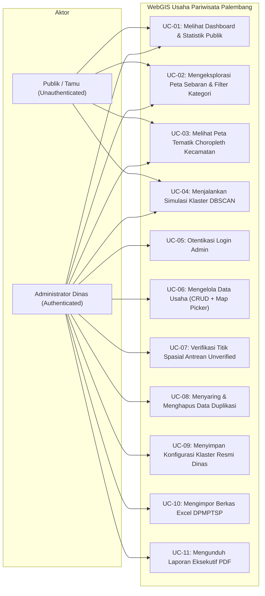

# PRODUCT REQUIREMENT DOCUMENT (PRD)
## SISTEM INFORMASI GEOGRAFIS BERBASIS WEB UNTUK PEMETAAN DAN KLASTERISASI USAHA PARIWISATA KOTA PALEMBANG MENGGUNAKAN ALGORITMA DBSCAN

* **Dokumen:** Product Requirement Document (PRD) Komprehensif  
* **Program Studi:** Sarjana Terapan (D4) Manajemen Informatika  
* **Jurusan:** Manajemen Informatika, Politeknik Negeri Sriwijaya (Polsri)  
* **Status Dokumen:** Baseline Resmi & Terkunci (Kitab Suci Proyek)  
* **Terakhir Diperbarui:** 23 Oktober 2026  

---

## DAFTAR ISI
1. [Problem Statement & Product Objectives](#1-problem-statement--product-objectives)
2. [User Roles, Privacy Governance, & Access Control Matrix](#2-user-roles-privacy-governance--access-control-matrix)
3. [Pemodelan Kebutuhan Pengguna (Use Case Modeling & Scenarios)](#3-pemodelan-kebutuhan-pengguna-use-case-modeling--scenarios)
4. [Kebutuhan Fungsional Sistem & Kamus Data (5 Modul Utama)](#4-kebutuhan-fungsional-sistem--kamus-data-5-modul-utama)
5. [Formulasi Matematis & Alur Algoritma DBSCAN](#5-formulasi-matematis--alur-algoritma-dbscan)
6. [Kebutuhan Non-Fungsional, Arsitektur Teknis, & Edge Cases](#6-kebutuhan-non-fungsional-arsitektur-teknis--edge-cases)
7. [Matriks Pengujian Sistem (Black Box Testing & Algorithmic Validation)](#7-matriks-pengujian-sistem-black-box-testing--algorithmic-validation)
8. [Roadmap Keberlanjutan ke Skripsi D4 Polsri](#8-roadmap-keberlanjutan-ke-skripsi-d4-polsri)

---

## 1. PROBLEM STATEMENT & PRODUCT OBJECTIVES

### 1.1 Konteks Regulasi & Latar Belakang Operasional
Berdasarkan **Peraturan Pemerintah (PP) No. 5 Tahun 2021 tentang Penyelenggaraan Perizinan Berusaha Berbasis Risiko**, seluruh perizinan berusaha di Indonesia dialihkan secara terpusat melalui sistem **Online Single Submission Risk-Based Approach (OSS-RBA)** yang didelegasikan di daerah melalui **Dinas Penanaman Modal dan Pelayanan Terpadu Satu Pintu (DPMPTSP)**.

Dampaknya terhadap tata kelola pemerintahan Kota Palembang:
* **Dinas Pariwisata Kota Palembang** tidak lagi memiliki wewenang menerbitkan izin usaha pariwisata secara mandiri, melainkan bertransformasi menjadi **instansi pembina dan pengawas teknis lapangan (*monitoring, evaluasi, dan post-audit*)**.
* Untuk melaksanakan fungsi monitoring berkala, Dinas Pariwisata diberikan hak akses akun pemantauan ke sistem OSS dan secara periodik menerima berkas rekapitulasi perizinan dari DPMPTSP dalam format tabular Excel (`Data Pariwisata.xlsx`).
* Namun, format data tabular tersebut tidak memadai untuk mendukung tugas operasional dinas dalam melakukan pemantauan faktual, pengendalian tata ruang wisata, maupun analisis potensi aglomerasi ekonomi pariwisata daerah.

---

### 1.2 Masalah Nyata di Lapangan (Problem Statement)
Berdasarkan hasil audit mendalam terhadap berkas perizinan `Data Pariwisata.xlsx` (total 2.809 baris data mentah), ditemukan 5 kendala utama:

1. **Cacat Geospasial Hulu (Ketiadaan Atribut Koordinat di OSS):**
   * Formulir pendaftaran OSS dari pemerintah pusat tidak mewajibkan pemohon izin mengisi titik koordinat geospasial (*Latitude* dan *Longitude*).
   * Akibatnya, seluruh 2.809 data yang diterima Dinas Pariwisata tidak memiliki informasi spasial, sehingga dinas mengalami "kebutaan geospasial" mengenai letak fisik tempat usaha di dunia nyata.
2. **Kualitas Data Teks Sangat Rendah dan Anomali (*Dirty Data*):**
   * Pendaftaran mandiri (*self-declaration*) oleh pelaku usaha memicu inkonsistensi input yang parah. Kolom nama proyek usaha bercampur antara nama badan hukum (PT/CV), nama pemilik pribadi, nama jalan, singkatan tidak baku, hingga karakter/simbol khusus.
   * **Masalah Nama Generik:** Banyak usaha yang didaftarkan hanya menggunakan nama generik kategorinya (contoh riil di Excel: usaha hotel bintang dinamai cuma *"Hotel Bintang"*, resto dinamai cuma *"Restoran"*, penginapan dinamai cuma *"Penginapan remaja"*), sehingga mempersulit verifikasi fisik bangunan di lapangan.
3. **Alamat Tidak Terstandarisasi untuk Pelacakan Digital:**
   * Sebagian besar alamat hanya mencantumkan nama jalan protokol tanpa nomor bangunan, atau sebaliknya hanya mencantumkan nomor RT/RW dan nama lorong sempit tanpa nama jalan utama. Kondisi ini membuat alamat gagal dilacak secara otomatis oleh mesin peta (Google Maps / OpenStreetMap).
4. **Akumulasi Riwayat Perizinan Ganda (Duplikasi Historis):**
   * DPMPTSP tidak berwenang menghapus riwayat pendaftaran izin lama kecuali atas permohonan pencabutan resmi dari pelaku usaha.
   * Akibatnya, terjadi penggembungan data semu di mana satu lokasi fisik yang sama terdaftar berulang kali di tanggal berbeda akibat pengajuan izin baru, perubahan modal, atau pergantian nama proyek.
5. **Keterbatasan Analisis Tabular terhadap Kerapatan Lapangan:**
   * Informasi rekapitulasi dinas selama ini hanya mampu menjumlahkan angka secara administratif per kecamatan. Format tabel ini **gagal memperlihatkan titik kumpul kerapatan riil di lapangan**: koridor jalan mana yang mengalami kejenuhan usaha pariwisata, dan area mana yang kekurangan fasilitas pendukung (*underserved*).

---

### 1.3 Ruang Lingkup Data & Strategi Status Ganda (*Dual-State Data Strategy*)
Sistem **tidak membuang** data dinas yang belum lengkap, melainkan menerapkan mekanisme **Status Verifikasi Spasial Ganda**:
* **Total Basis Data:** **2.809 baris data usaha perizinan dinas** disimpan ke dalam sistem database MySQL.
* **Status Verified (1.421 data):** Data yang telah tervalidasi memiliki titik koordinat presisi di dalam Kota Palembang. Data inilah yang diproses secara aktif oleh algoritma DBSCAN dan ditampilkan pada peta publik.
* **Status Unverified (1.388 data):** Data yang koordinatnya masih kosong tetap tersimpan rapi di database internal sebagai antrean verifikasi untuk dilengkapi bertahap oleh staf dinas.

#### Rincian Data Terverifikasi per Kategori KBLI (1.421 Titik):
| Kode KBLI | Kategori Usaha | Jumlah Titik Siap Klaster |
| :---: | :--- | :---: |
| 56101 | Restoran | 709 |
| 56303 | Rumah Minum / Kafe | 307 |
| 79121 | Aktivitas Biro Perjalanan Wisata | 113 |
| 79122 | Aktivitas Biro Perjalanan Umroh | 107 |
| 55110 | Hotel Bintang | 60 |
| 55120 | Hotel Melati | 35 |
| 56301 | Bar | 27 |
| 93292 | Karaoke | 21 |
| 55191 | Penginapan Remaja (Youth Hostel) | 20 |
| 93293 | Usaha Arena Permainan | 20 |
| 93291 | Klub Malam | 2 |
| **TOTAL** | **Seluruh Usaha Pariwisata Siap Klaster** | **1.421 Titik** |

---

### 1.4 Tujuan Produk (Product Objectives)
Sistem Informasi Geografis Berbasis Web (WebGIS) ini dibangun dengan 3 tujuan utama:

1. **Pemetaan Sebaran Usaha Pariwisata Multi-Mode:**
   * **Mode Administratif (Choropleth):** Menampilkan visualisasi batas 18 kecamatan Kota Palembang dengan gradasi warna berdasarkan kepadatan total izin usaha per kecamatan.
   * **Mode Spasial Interaktif:** Memetakan 1.421 titik usaha berkoordinat ke atas peta digital (Leaflet.js) yang dilengkapi filter multi-kategori (KBLI) dan fitur pencarian nama usaha.
2. **Klasterisasi Zona Konsentrasi Menggunakan Algoritma DBSCAN:**
   * Menerapkan algoritma DBSCAN dengan matriks jarak *Haversine* untuk mengekstrak zona-zona konsentrasi (aglomerasi) usaha pariwisata secara organik tanpa terikat batas birokrasi kecamatan.
   * Menampilkan poligon area konsentrasi kawasan pariwisata dan secara otomatis memisahkan usaha-usaha terpencil di pinggiran sebagai titik *noise*.
3. **Pengelolaan Data Terintegrasi (CRUD Mandiri & Validasi):**
   * Menyediakan formulir penambahan dan pembaruan data usaha berstandar OSS yang dilengkapi **Interactive Map Picker (Pin Marker Drag-and-Drop)** agar penambahan data baru memiliki koordinat presisi instan tanpa biaya API.
   * Menyediakan modul impor data Excel berkala dari DPMPTSP dengan pemilahan status otomatis.

---

## 2. USER ROLES, PRIVACY GOVERNANCE, & ACCESS CONTROL MATRIX

### 2.1 Definisi Aktor Sistem
1. **Publik / Tamu (*Public Guest*):**
   * **Sifat Akses:** Tanpa Login (*Unauthenticated* / Akses Terbuka).
   * **Fungsi:** Masyarakat, calon investor, akademisi, dan dewan penguji sidang yang mengakses portal untuk melihat informasi sebaran usaha, peta tematik kecamatan, dan melakukan simulasi klaster DBSCAN secara interaktif.
   * **Batasan:** Bersifat *stateless* (hanya baca). Simulasi parameter hanya berjalan di layar browser sendiri dan tidak dapat mengubah basis data dinas.
2. **Administrator (Staf Teknis Dinas Pariwisata):**
   * **Sifat Akses:** Wajib Login (*Authenticated* via Email & Password terenkripsi).
   * **Fungsi:** Pengelola resmi data perizinan pariwisata Kota Palembang.
   * **Wewenang:** Memegang kendali penuh atas basis data (CRUD), verifikasi koordinat, impor berkas DPMPTSP, penetapan klaster resmi dinas, dan pencetakan laporan PDF.

### 2.2 Kebijakan Privasi & Citra Publik (*Data Governance*)
* **Halaman Publik:** Hanya menampilkan data bersih yang telah terverifikasi (**1.421 Usaha**). Angka 1.388 data kosong disembunyikan untuk menjaga reputasi kinerja instansi pemerintah dari tudingan publik mengenai data perizinan yang tidak lengkap.
* **Halaman Admin:** Menampilkan statistik mutu data lengkap (2.809 total, 1.421 verified, 1.388 unverified) sebagai antrean kerja penjaminan mutu data internal (*data quality assurance*).

### 2.3 Matriks Hak Akses (Access Control Matrix)

| No | Modul / Fitur Sistem | Publik / Tamu (Tanpa Login) | Admin Dinas (Wajib Login) | Keterangan & Batasan Hak Akses |
| :-: | :--- | :---: | :---: | :--- |
| **1** | **Dashboard Statistik Publik** | ✅ Ya | ✅ Ya | Menampilkan 1.421 data terverifikasi (angka 1.388 disembunyikan dari publik). |
| **2** | **Dashboard Mutu Data Internal** | ❌ **Dilarang** | ✅ **Ya** | Khusus Admin: Menampilkan rasio kelengkapan data (Total: 2.809 \| Verified: 1.421 \| Unverified: 1.388). |
| **3** | **Peta Sebaran Usaha (Katalog)** | ✅ Ya | ✅ Ya | Menampilkan 1.421 marker usaha, filter multi-kategori KBLI, pencarian nama/alamat, dan popup detail info. |
| **4** | **Peta Tematik Kecamatan (Choropleth)** | ✅ Ya | ✅ Ya | Menampilkan batas 18 kecamatan Palembang dengan gradasi warna berdasarkan kepadatan total usaha. |
| **5** | **Simulasi DBSCAN Interaktif** | ✅ Ya | ✅ Ya | Bebas mengubah parameter $\varepsilon$ (meter), $MinPts$, serta filter sektor untuk simulasi *on-the-fly*. |
| **6** | **Melihat Metrik *Silhouette Score*** | ✅ Ya | ✅ Ya | Nilai validitas kualitas klaster tampil *real-time* saat simulasi dijalankan (keperluan uji sidang). |
| **7** | **Kunci Klaster Resmi Dinas** | ❌ **Dilarang** | ✅ **Ya** | Menyimpan parameter optimal ke database sebagai standar klaster acuan resmi dinas. |
| **8** | **Kelola Data Usaha (CRUD)** | ❌ **Dilarang** | ✅ **Ya** | Tambah usaha baru, edit atribut usaha, dan hapus data (form berstandar atribut OSS). |
| **9** | **Map Picker (Drag-and-Drop Pin)** | ❌ **Dilarang** | ✅ **Ya** | Menentukan titik koordinat presisi langsung di atas peta Leaflet saat input/edit (bebas biaya API). |
| **10**| **Verifikasi Data Spasial** | ❌ **Dilarang** | ✅ **Ya** | Melengkapi koordinat 1.388 data antrean (*unverified*) agar statusnya naik menjadi *verified*. |
| **11**| **Filter Deteksi Duplikasi** | ❌ **Dilarang** | ✅ **Ya** | Menyaring data ganda (NIB sama / nama identik) akibat riwayat pendaftaran berulang di OSS. |
| **12**| **Import Berkas Excel DPMPTSP** | ❌ **Dilarang** | ✅ **Ya** | Mengunggah file rekapitulasi baru dari DPMPTSP dengan pemilahan otomatis (*verified* vs *unverified*). |
| **13**| **Cetak Laporan Resmi (PDF)** | ❌ **Dilarang** | ✅ **Ya** | Menghasilkan dokumen laporan formal hasil klasterisasi dan rekapitulasi untuk pimpinan dinas. |

---

## 3. PEMODELAN KEBUTUHAN PENGGUNA (USE CASE MODELING & SCENARIOS)

### 3.1 Use Case Diagram Sistem

---

### 3.2 Skenario Use Case Spesifik

#### UC-04: Menjalankan Simulasi Klaster DBSCAN
* **Aktor:** Publik / Tamu dan Administrator Dinas
* **Kondisi Awal (*Pre-condition*):** Pengguna berada di halaman Analisis DBSCAN; 1.421 data terverifikasi telah dimuat di sistem.
* **Kondisi Akhir (*Post-condition*):** Peta menampilkan poligon klaster berwarna, titik noise berwarna abu-abu, dan nilai Silhouette Score.
* **Alur Utama (*Main Flow*):**
  1. Pengguna memilih cakupan data: "Semua Usaha" atau salah satu kategori khusus (misal: "Rumah Minum/Kafe").
  2. Pengguna memasukkan nilai parameter jarak radius $\varepsilon$ (*Epsilon*) dalam meter (contoh: `500`).
  3. Pengguna memasukkan nilai ambang batas titik tetangga minimum *MinPts* (contoh: `5`).
  4. Pengguna menekan tombol `[ PROSES KLASTERISASI ]`.
  5. Sistem mengirim request via AJAX ke Controller Laravel.
  6. Controller menghitung matriks jarak Haversine, mengelompokkan Core Point, Border Point, dan Noise, serta menghitung nilai Silhouette Coefficient.
  7. Sistem mengembalikan respons data JSON berisi daftar titik berlabel klaster dan koordinat batas poligon (*Convex Hull*).
  8. Peta Leaflet.js merender ulang tampilan: titik dikelompokkan dengan warna berbeda, poligon area transparan membungkus klaster, titik noise diwarnai abu-abu redup, dan panel metrik menampilkan jumlah klaster serta nilai Silhouette Score.

#### UC-06: Mengelola Data Usaha dengan Map Picker (Tambah Usaha Baru)
* **Aktor:** Administrator Dinas Pariwisata
* **Kondisi Awal:** Admin telah berhasil login dan berada di halaman Kelola Data Usaha.
* **Kondisi Akhir:** Data usaha baru tersimpan ke database MySQL dengan status `verified` dan koordinat valid.
* **Alur Utama:**
  1. Admin menekan tombol `[ + Tambah Usaha Baru ]`.
  2. Sistem menampilkan modal formulir atribut usaha beserta panel peta interaktif Leaflet di sisi kanan form.
  3. Admin mengisi atribut teks: NIB, Nama Perusahaan, Nama Proyek Usaha, KBLI, Skala Usaha, Alamat Usaha, Kecamatan, Kelurahan, dan Tenaga Kerja (TKI).
  4. Admin mengetikkan nama jalan pada kotak pencarian peta Leaflet, lalu peta bergerak ke perkiraan lokasi.
  5. Muncul pin marker interaktif (*draggable*). Admin menggeser pin marker tersebut menggunakan kursor tepat di atas atap bangunan ruko usahanya.
  6. Saat pin dilepas (*dragend*), kolom input `latitude` dan `longitude` otomatis terisi angka koordinat presisi.
  7. Admin menekan tombol `[ Simpan Data Usaha ]`.
  8. Sistem memvalidasi data; jika valid, data disimpan ke database MySQL dengan status `status_spasial = 'verified'`.
  9. Sistem menampilkan notifikasi sukses dan tabel data ter-refresh secara otomatis.

#### UC-07: Verifikasi Titik Spasial Antrean Unverified
* **Aktor:** Administrator Dinas Pariwisata
* **Kondisi Awal:** Admin berada di tab *"Belum Ada Titik / Antrean (1.388)"*.
* **Alur Utama:**
  1. Admin memilih salah satu baris usaha pada tabel antrean yang alamatnya ingin diverifikasi.
  2. Admin mengklik tombol aksi `[ Tentukan Titik ]`.
  3. Sistem memunculkan jendela peta *Map Picker* dengan informasi nama proyek dan alamat usaha yang bersangkutan.
  4. Admin mencari lokasi fisik bangunan usaha tersebut dan mengklik peta tepat pada posisi gedung.
  5. Koordinat tersimpan, sistem mengubah kolom status dari `unverified` menjadi `verified`.
  6. Data tersebut otomatis keluar dari antrean dan masuk ke daftar 1.421 data aktif untuk klasterisasi.

#### UC-10: Mengimpor Berkas Excel DPMPTSP
* **Aktor:** Administrator Dinas Pariwisata
* **Alur Utama:**
  1. Admin membuka menu Impor Berkas, lalu memilih file Excel (`.xlsx`) laporan berkala dari DPMPTSP.
  2. Admin menekan tombol `[ Unggah & Proses ]`.
  3. Sistem mem-parsing berkas Excel baris demi baris:
     * Baris yang NIB dan Nama Proyeknya sudah ada diabaikan (*skip duplicate*).
     * Baris baru yang sudah memiliki koordinat valid disimpan dengan status `verified`.
     * Baris baru yang tidak memiliki koordinat disimpan dengan status `unverified`.
  4. Sistem menampilkan ringkasan laporan hasil impor: jumlah baris terbaca, jumlah data sukses masuk verified, jumlah data masuk antrean, dan jumlah duplikasi yang ditolak.

#### UC-11: Mengunduh Laporan Eksekutif PDF
* **Aktor:** Administrator Dinas Pariwisata
* **Alur Utama:**
  1. Admin memilih menu Cetak Laporan dan menentukan tipe laporan: *Laporan Hasil Klasterisasi Spasial DBSCAN*.
  2. Admin menekan tombol `[ Unduh Laporan PDF ]`.
  3. Sistem (via library `dompdf`) merender data hasil klasterisasi resmi dinas ke dalam format dokumen A4 berstandar instansi pemerintah (memuat Kop Surat Dinas Pariwisata, parameter $\varepsilon$ dan $MinPts$, nilai Silhouette Score, tabel zonasi kawasan sentra wisata, dan kolom tanda tangan pimpinan).
  4. Berkas PDF otomatis terunduh ke perangkat lokal admin.

---

## 4. KEBUTUHAN FUNGSIONAL SISTEM & KAMUS DATA (5 MODUL UTAMA)

Estetika antarmuka mengadopsi standar modern portal pemerintah (*clean, spacious, and responsive*) seperti pada portal **Gastrodiplomasi Kemlu RI** menggunakan **Tailwind CSS**, tipografi **Plus Jakarta Sans**, dan kontrol mengambang (*floating controls*) pada peta.

---

### Modul 1: Dashboard & Statistik (FR-01)
* **Deskripsi:** Halaman beranda pertama sistem yang menyajikan ringkasan eksekutif aset usaha pariwisata.
* **Komponen Antarmuka:**
  1. **4 Kartu Metrik Ringkasan:** Menampilkan angka besar: Total Usaha Terverifikasi (1.421), Sektor Kuliner (1.016), Sektor Akomodasi (115), Sektor Rekreasi & Jasa (290).
  2. **Diagram Batang (Distribusi per Kecamatan):** Menampilkan perbandingan jumlah usaha di 18 kecamatan Kota Palembang secara terurut dari terpadat (Ilir Barat I) hingga tersepi (Gandus).
  3. **Diagram Donat (Proporsi Kategori):** Menampilkan persentase pembagian usaha (71,5% Kuliner, 15,5% Biro Travel, 8,1% Akomodasi, 4,9% Hiburan).
* **Perbedaan Role:** Publik hanya melihat angka 1.421 terverifikasi; Admin melihat kartu tambahan mutu data internal (2.809 total data vs 1.388 data antrean).

---

### Modul 2: Peta Sebaran & Choropleth (FR-02)
* **Deskripsi:** Modul pemetaan multi-mode untuk menjawab fungsi "Pemetaan" pada judul.
* **Fitur Sub-Modul:**
  1. **Tab 1: Peta Sebaran Usaha (Katalog Spasial):**
     * Menampilkan 1.421 marker pin dengan warna berbeda per sektor (Hotel = Biru, Kuliner = Oranye, Travel = Hijau, Hiburan = Ungu).
     * Panel Filter Checklist Kategori: Pengguna dapat mencentang/menonaktifkan kategori tertentu.
     * Kolom Pencarian (*Search Bar*): Fitur *auto-zoom* ke lokasi tempat usaha yang dicari.
     * *Popup Information Card:* Mengklik pin membuka informasi lengkap (Nama Proyek, Nama Perusahaan, Alamat, Kategori KBLI, NIB, Skala Usaha, TKI).
  2. **Tab 2: Peta Tematik Kepadatan per Kecamatan (Choropleth):**
     * Menyembunyikan seluruh pin usaha dan menampilkan batas poligon 18 kecamatan dari file `palembang.geojson`.
     * Mewarnai setiap kecamatan secara otomatis menggunakan gradasi warna kepadatan (Hijau = Sepi $<30$ usaha, Kuning/Oranye = Sedang $30-150$ usaha, Merah Tua = Sangat Padat $>200$ usaha).
     * *Hover & Tooltip:* Mengarahkan kursor mouse ke poligon kecamatan menampilkan ringkasan jumlah usaha di wilayah tersebut.

---

### Modul 3: Analisis Spasial DBSCAN (FR-03) - *Jantung Sistem*
* **Deskripsi:** Modul komputasi data mining spasial untuk menemukan zona konsentrasi dan menyaring noise.
* **Alur Operasional:**
  1. **Panel Kontrol Parameter (Kiri):**
     * Dropdown Cakupan Data: Pilihan klasterisasi *"Semua Usaha (1.421)"* atau per sektor spesifik (*"Khusus Kuliner"*, *"Khusus Hotel"*, dll).
     * Input Parameter $\varepsilon$ (*Epsilon*): Input angka jarak radius dalam satuan meter (default: `500`).
     * Input Parameter *MinPts*: Input angka minimal kerapatan usaha bertetangga (default: `5`).
     * Tombol: `[ PROSES KLASTERISASI ]`.
  2. **Proses Komputasi Backend (Laravel):**
     * Menghitung matriks jarak antar titik koordinat menggunakan formula **Haversine Distance**.
     * Mengklasifikasikan titik ke dalam status **Core Point**, **Border Point**, atau **Noise**.
     * Membentuk poligon pembungkus area konsentrasi (*Convex Hull*) untuk setiap klaster yang terbentuk.
     * Menghitung nilai validitas klaster secara matematis menggunakan **Silhouette Coefficient**.
  3. **Visualisasi Hasil Peta (Kanan):**
     * Titik-titik marker otomatis berubah warna sesuai kelompok klasternya (Klaster 1 = Merah, Klaster 2 = Biru, Klaster 3 = Hijau, dst).
     * Lapisan poligon area transparan membungkus titik-titik dalam klaster yang sama.
     * Usaha yang terisolasi di pinggiran secara otomatis diwarnai **Abu-Abu Redup (*Noise*)**.
     * Menampilkan panel kartu ringkasan: Total klaster yang terbentuk, jumlah usaha per klaster, jumlah titik noise, dan nilai *Silhouette Score*.
  4. **Wewenang Admin:** Tombol khusus `[ Simpan sebagai Klaster Resmi Dinas ]` untuk mengunci kombinasi parameter optimal ke database.

---

### Modul 4: Manajemen Data Usaha & Verifikasi (FR-04)
* **Deskripsi:** Modul operasional internal dinas untuk pemeliharaan data (*Back-Office CRUD*).
* **Fitur Sub-Modul:**
  1. **Tabel DataTables Pintar dengan 4 Tab Filter:**
     * Tab `Semua Data (2.809)`
     * Tab `Terverifikasi / Ada Titik (1.421)`
     * Tab `Belum Ada Titik / Antrean (1.388)`
     * Tab `Indikasi Duplikasi (NIB / Nama Sama)`
  2. **Form Input/Edit dengan "Interactive Map Picker":**
     * Kolom input atribut lengkap sesuai standar OSS.
     * Di samping form terdapat peta interaktif Leaflet. Staf dinas dapat mengetik alamat atau langsung **menggeser pin marker (*drag-and-drop*)** tepat di atas atap bangunan ruko usahanya.
     * Kolom `Latitude` dan `Longitude` otomatis terisi angka koordinat presisi begitu pin digeser.
  3. **Alur Verifikasi Cepat Data Antrean:**
     * Staf membuka tab *Belum Ada Titik (1.388)* $\rightarrow$ klik tombol `[ Tentukan Titik ]` $\rightarrow$ klik posisi di peta $\rightarrow$ klik simpan. Status data otomatis berubah menjadi *Verified* dan langsung aktif masuk ke perhitungan DBSCAN berikutnya.
  4. **Pembersihan Data Duplikat:**
     * Tombol filter duplikasi mendeteksi riwayat permohonan ganda ber-NIB sama, memungkinkan staf dinas menghapus entri usang dengan aman.

---

### Modul 5: Impor Excel & Laporan Resmi PDF (FR-05)
* **Deskripsi:** Modul integrasi berkas eksternal dan pencetakan dokumen formal dinas.
* **Fitur Sub-Modul:**
  1. **Impor Berkas Excel DPMPTSP:**
     * Admin mengunggah berkas `.xlsx` hasil ekspor berkala DPMPTSP.
     * Sistem memvalidasi dan memilah otomatis: baris yang sudah memiliki koordinat masuk sebagai `Verified`, baris tanpa koordinat masuk antrean `Unverified`, dan baris yang NIB + Namanya sudah terdaftar ditolak (*skip duplicate*).
     * Sistem menampilkan log ringkasan impor.
  2. **Ekspor Laporan Resmi Eksekutif (PDF):**
     * Menggunakan library `barryvdh/laravel-dompdf` untuk mencetak dokumen format A4 berstandar instansi pemerintah (dilengkapi Kop Surat Dinas Pariwisata Kota Palembang).
     * Opsi cetak: *Laporan Hasil Klasterisasi Spasial DBSCAN* dan *Laporan Rekapitulasi Usaha per Kecamatan*.
     * Memuat kolom tanda tangan resmi Kepala Dinas / Pembina Teknis.

---

### 4.6 Kamus Data Atribut Formulir OSS & Aturan Validasi Laravel (*Data Dictionary*)

Tabel basis data utama adalah `usaha_pariwisata` dengan skema atribut berikut:

| Nama Kolom SQL | Tipe Data MySQL | Aturan Validasi Laravel | Deskripsi & Contoh Nilai |
| :--- | :--- | :--- | :--- |
| `id` | `BIGINT UNSIGNED AUTO_INCREMENT` | `primary_key` | Identifier unik baris data usaha. |
| `nib` | `VARCHAR(30)` | `required\|string\|max:30` | Nomor Induk Berusaha OSS (contoh: `9120205132935`). |
| `nama_perusahaan` | `VARCHAR(255)` | `required\|string\|max:255` | Nama badan hukum pemilik izin (contoh: `PT. Permata Surya Abadi`). |
| `nama_proyek` | `VARCHAR(255)` | `required\|string\|max:255` | Nama brand komersial usaha (contoh: `Hotel Permata Palembang`). |
| `kbli` | `VARCHAR(10)` | `required\|string\|max:10` | Kode Klasifikasi Baku Lapangan Usaha (contoh: `55110`). |
| `judul_kbli` | `VARCHAR(150)` | `required\|string\|max:150` | Nomenklatur kategori usaha (contoh: `Hotel Bintang`). |
| `skala_usaha` | `ENUM(...)` | `required\|in:Usaha Mikro,Usaha Kecil,Usaha Menengah,Usaha Besar` | Skala investasi usaha berbasis modal kerja. |
| `uraian_risiko` | `VARCHAR(50)` | `nullable\|string\|max:50` | Tingkat risiko proyek (Rendah, Menengah Rendah, Menengah Tinggi, Tinggi). |
| `alamat_usaha` | `TEXT` | `required\|string` | Alamat fisik lokasi operasional usaha. |
| `kecamatan` | `VARCHAR(100)` | `required\|string\|max:100` | Wilayah administratif kecamatan di Kota Palembang. |
| `kelurahan` | `VARCHAR(100)` | `required\|string\|max:100` | Wilayah administratif kelurahan di Kota Palembang. |
| `tki` | `INT UNSIGNED` | `nullable\|integer\|min:0` | Jumlah Tenaga Kerja Indonesia yang terserap. |
| `latitude` | `DECIMAL(10, 8)` | `nullable\|numeric\|between:-3.3,-2.7` | Titik koordinat lintang bumi (wajib dalam batas Palembang). |
| `longitude` | `DECIMAL(11, 8)` | `nullable\|numeric\|between:104.5,105.1` | Titik koordinat bujur bumi (wajib dalam batas Palembang). |
| `status_spasial` | `ENUM('verified','unverified')`| `required\|in:verified,unverified` | Penanda kelayakan data untuk perhitungan DBSCAN. |
| `created_at` / `updated_at` | `TIMESTAMP` | `nullable` | Jejak waktu pencatatan sistem Laravel. |

---

## 5. FORMULASI MATEMATIS & ALUR ALGORITMA DBSCAN

### 5.1 Perhitungan Jarak Spasial Geografis (*Haversine Distance*)
Karena permukaan bumi berbentuk bulat lonjong (*oblate spheroid*), perhitungan jarak antara dua titik koordinat $(\text{lat}_1, \text{lon}_1)$ dan $(\text{lat}_2, \text{lon}_2)$ tidak boleh menggunakan jarak datar Pythagoras biasa. Sistem menggunakan rumus **Haversine** untuk menghitung jarak lengkung bumi terpendek (*great-circle distance*) dalam satuan meter:

$$\Delta\text{lat} = \text{rad}(\text{lat}_2 - \text{lat}_1)$$

$$\Delta\text{lon} = \text{rad}(\text{lon}_2 - \text{lon}_1)$$

$$a = \sin^2\left(\frac{\Delta\text{lat}}{2}\right) + \cos(\text{rad}(\text{lat}_1)) \cdot \cos(\text{rad}(\text{lat}_2)) \cdot \sin^2\left(\frac{\Delta\text{lon}}{2}\right)$$

$$c = 2 \cdot \text{atan2}\left(\sqrt{a}, \sqrt{1-a}\right)$$

$$d = R \cdot c$$

* Dimana:
  * $R = 6.371.000\text{ meter}$ (Jari-jari rata-rata bumi).
  * $d$ = Jarak fisik antara dua titik usaha dalam satuan meter.

---

### 5.2 Definisi Inti Algoritma DBSCAN
1. **$\varepsilon$-Neighborhood (Jangkauan Radius Tetangga):**
   $$N_\varepsilon(p) = \{q \in D \mid \text{dist}(p, q) \le \varepsilon\}$$
2. **Core Point (Titik Inti):** Titik $p$ dinyatakan sebagai Core Point jika jumlah tetangganya memenuhi:
   $$|N_\varepsilon(p)| \ge MinPts$$
3. **Border Point (Titik Batas):** Titik $q$ bukan Core Point, tetapi berada di dalam radius Core Point lain:
   $$q \in N_\varepsilon(p) \quad \text{dimana } p \text{ adalah Core Point}$$
4. **Noise (Pencilan):** Titik yang bukan Core Point dan tidak berada dalam radius Core Point mana pun:
   $$\{p \in D \mid p \text{ bukan Core Point dan } p \text{ bukan Border Point}\}$$

---

### 5.3 Flowchart Logika Algoritma DBSCAN

---

### 5.4 Evaluasi Kualitas Klaster (*Silhouette Coefficient*)
Untuk setiap titik $i$ dalam klaster, dihitung:
* $a(i)$ = rata-rata jarak titik $i$ ke seluruh titik lain di dalam klaster yang sama (*cohesion*).
* $b(i)$ = rata-rata jarak terkecil dari titik $i$ ke seluruh titik di klaster tetangga terdekat (*separation*).

Nilai Silhouette untuk titik $i$:
$$s(i) = \frac{b(i) - a(i)}{\max(a(i), b(i))}$$

Rata-rata seluruh $s(i)$ menghasilkan **Silhouette Score Global (SC)** yang berkisar antara $-1$ hingga $+1$. Nilai $\ge 0.50$ membuktikan bahwa klaster padat dan terpisah dengan baik secara spasial.

---

## 6. KEBUTUHAN NON-FUNGSIONAL, ARSITEKTUR TEKNIS, & EDGE CASES

### 6.1 Batasan Kinerja Sistem (*Performance*)
* **Waktu Muat Peta Awal (*Map Load Time*):** Render awal 1.421 titik marker pada Leaflet.js harus selesai dalam waktu **$\le 3$ detik**.
* **Kecepatan Eksekusi DBSCAN (*Execution Speed*):** Perhitungan matriks jarak Haversine, clustering, dan kalkulasi Silhouette Coefficient pada 1.421 titik di Controller Laravel harus tuntas dalam waktu **$\le 2$ detik**.

### 6.2 Spesifikasi Stack Teknologi Terverifikasi
* **Bahasa & Runtime Backend:** **PHP 8.2** (Terverifikasi versi `8.2.12` di lokal XAMPP).
* **Framework Backend:** **Laravel** (Versi 10 atau 11, Composer `2.8.11`).
* **Database Management System:** **MySQL** (berjalan lokal di server XAMPP).
* **Frontend & Tampilan:** Blade Template + **Tailwind CSS** (estetika modern ala Kemlu Gastrodiplomasi dengan font Google *Plus Jakarta Sans*).
* **Mesin Peta Spasial:** **Leaflet.js** (versi 1.9+ via CDN, *open-source*, bebas biaya lisensi API).
* **Peta Dasar (*Basemap*):** CartoDB Positron / OpenStreetMap (peta abu-abu terang minimalis).
* **Data Batas Wilayah Administrasi:** Berkas vektor **GeoJSON (`palembang.geojson`)** batas 18 kecamatan Kota Palembang.
* **Modul Laporan:** Library `barryvdh/laravel-dompdf`.

### 6.3 Keamanan & Integritas Data (*Security & Integrity*)
* **Proteksi Akses Admin:** Seluruh rute manajemen data (CRUD), verifikasi koordinat, impor Excel, dan penetapan klaster resmi wajib dilindungi **Middleware `auth` Laravel**.
* **Enkripsi Kredensial:** Password akun staf dinas dienkripsi menggunakan algoritma **Bcrypt** standar Laravel.
* **Pencegahan Serangan Manipulasi Formulir:** Seluruh transaksi data (tambah, edit, hapus) wajib menyertakan **CSRF Token**.
* **Isolasi Database dari Akses Publik:** Eksekusi simulasi DBSCAN oleh publik bersifat **sementara (*stateless*)** di memori browser dan **dilarang menyentuh tabel konfigurasi database dinas**.

### 6.4 Kompatibilitas & Responsivitas (*Mobile-Friendly*)
* **Dukungan Seluler (*Mobile Responsiveness*):** Antarmuka peta dan dashboard responsif penuh pada layar ponsel pintar ($\ge 375$ px) dengan panel kontrol yang dapat dilipat (*collapsible/drawer*).
* **Dukungan Desktop:** Mendukung resolusi proyektor standar ($1366 \times 768$ px) hingga monitor Full HD ($1920 \times 1080$ px).
* **Dukungan Peramban (*Cross-Browser*):** Berjalan stabil pada Google Chrome, Microsoft Edge, Mozilla Firefox, dan Safari.

### 6.5 Penanganan Kasus Ekstrem & Error Handling (*Edge Cases*)
1. **Penanganan Koordinat di Luar Batas Wilayah Palembang:**
   * Jika titik yang digeser atau diinput berada di luar *bounding box* Palembang (Lintang: $-3.3$ s/d $-2.7$, Bujur: $104.5$ s/d $105.1$), sistem membatalkan penyimpanan dan memunculkan notifikasi error: *"Koordinat berada di luar wilayah Kota Palembang"*.
2. **Penanganan Parameter Ekstrem DBSCAN:**
   * Jika pengguna memasukkan $\varepsilon \le 0$ atau $MinPts < 2$, sistem otomatis menetapkan batas bawah minimal ($\varepsilon = 50\text{ m}$, $MinPts = 2$) untuk mencegah komputasi memori tak terhingga (*infinite loop / division by zero*).
3. **Penanganan Kondisi Seluruh Data Menjadi Noise (Zero Clusters):**
   * Jika pengguna memasukkan nilai $\varepsilon$ terlalu kecil (misal: 10 meter) sehingga tidak ada titik yang memenuhi syarat Core Point, sistem tidak boleh crash/error 500. Sistem menampilkan peta dengan seluruh titik berwarna abu-abu (*noise*) dan menampilkan banner notifikasi: *"Tidak ada klaster yang terbentuk pada parameter ini. Cobalah memperbesar nilai Epsilon."*
4. **Penanganan File Excel Rusak / Format Kolom Salah:**
   * Jika file yang diunggah pada modul impor tidak memiliki kolom NIB atau nama proyek, sistem menolak file sebelum diproses dan memunculkan pesan validasi: *"Berkas Excel tidak sesuai dengan template format OSS DPMPTSP."*

### 6.6 Target Deployment & Version Control (Syarat Kelulusan Polsri)
* **Version Control System (VCS):** Seluruh kode sumber dikelola menggunakan **Git** dan dicadangkan (*backup*) pada repositori **GitHub** pribadi mahasiswa.
* **Kesiapan Rilis Daring (*Production Deployment*):** Aplikasi dan database MySQL siap diunggah ke platform hosting publik (misal: Railway / Render / Vercel + TiDB / Shared Hosting) agar memiliki tautan URL aktif (*live URL*) yang dapat diuji langsung oleh dewan penguji sidang Polsri.

---

## 7. MATRIKS PENGUJIAN SISTEM (BLACK BOX TESTING & ALGORITHMIC VALIDATION)

### 7.1 Tabel Skenario Pengujian Black Box Testing

| No | Modul Pengujian | Skenario Uji | Data Masukan (Test Input) | Hasil yang Diharapkan (Expected Result) | Kriteria Sukses |
| :-: | :--- | :--- | :--- | :--- | :---: |
| **TC-01** | **Autentikasi** | Akses rute admin tanpa login | Membuka URL `localhost/admin/data-usaha` | Sistem otomatis menolak akses dan me-redirect ke halaman `localhost/login`. | **VALID** |
| **TC-02** | **Autentikasi** | Login dengan kredensial salah | Email / password tidak terdaftar | Sistem menampilkan pesan error: *"Kredensial yang diberikan tidak cocok."* | **VALID** |
| **TC-03** | **Peta Sebaran** | Filter multi-kategori KBLI | Mematikan checklist "Biro Perjalanan" | Seluruh marker hijau biro travel hilang seketika dari peta; kategori lain tetap tampil. | **VALID** |
| **TC-04** | **Peta Sebaran** | Pencarian nama usaha | Mengetik teks *"Aryaduta"* pada search bar | Peta otomatis melakukan *pan & zoom* mengarah tepat ke marker Hotel Aryaduta. | **VALID** |
| **TC-05** | **Peta Choropleth** | Hover kursor pada poligon kecamatan | Mengarahkan kursor ke Kec. Ilir Barat I | Muncul tooltip popover: *"Kecamatan Ilir Barat I: Total 412 Usaha Terdaftar"*. | **VALID** |
| **TC-06** | **DBSCAN Simulation** | Eksekusi parameter standar | $\varepsilon = 500\text{ m}, MinPts = 5$, Sektor: Semua | Peta menghasilkan marker berwarna klaster, poligon area terbentuk, titik noise abu-abu, dan skor Silhouette tampil. | **VALID** |
| **TC-07** | **DBSCAN Simulation** | Eksekusi parameter ekstrim kecil | $\varepsilon = 10\text{ m}, MinPts = 20$ | Tidak ada error 500; sistem menampilkan pesan ramah bahwa semua titik menjadi noise. | **VALID** |
| **TC-08** | **CRUD Usaha** | Tambah data via Map Picker | Menggeser pin ke atap gedung ruko | Input Latitude & Longitude otomatis terisi angka presisi; data tersimpan berstatus verified. | **VALID** |
| **TC-09** | **CRUD Usaha** | Validasi koordinat luar wilayah | Menginput Lat: `-6.2088` (Jakarta) | Sistem menolak simpan dengan pesan: *"Koordinat berada di luar wilayah Palembang."* | **VALID** |
| **TC-10** | **Verifikasi Spasial** | Menandai titik data antrean | Klik data unverified $\rightarrow$ tandai titik di peta | Status data otomatis berubah dari `unverified` menjadi `verified`, aktif di kalkulasi DBSCAN. | **VALID** |
| **TC-11** | **Impor Excel** | Upload berkas valid DPMPTSP | File `Data_Pariwisata.xlsx` | Sistem mengimpor data; memisahkan verified vs unverified dan menolak duplikasi NIB. | **VALID** |
| **TC-12** | **Ekspor PDF** | Unduh laporan resmi dinas | Klik tombol `[ Cetak Laporan PDF ]` | Mengunduh file PDF A4 ber-Kop Surat resmi yang memuat tabel ringkasan klasterisasi dan tanda tangan dinas. | **VALID** |

---

### 7.2 Tolok Ukur Validasi Algoritma DBSCAN
* Pengujian kualitas klaster dilakukan dengan memvariasikan nilai parameter:
  * Skenario Uji 1: $\varepsilon = 300\text{ meter}, MinPts = 4$
  * Skenario Uji 2: $\varepsilon = 500\text{ meter}, MinPts = 5$ (Skenario Utama)
  * Skenario Uji 3: $\varepsilon = 750\text{ meter}, MinPts = 6$
* **Standar Kelulusan:** Kombinasi parameter terbaik wajib menghasilkan nilai **Silhouette Score $\ge 0.50$** untuk membuktikan keilmiahan klaster di depan dewan penguji sidang Polsri.

---

### 7.3 Bukti Luaran Fisik (*Deliverables Checklist*)
1. Repositori kode sumber aktif di **GitHub** dengan riwayat commit rapi.
2. Tautan **Live Demo URL** yang dapat diakses daring oleh dewan penguji.
3. Dokumen Bab 4 dan Bab 5 Skripsi yang menyajikan analisis klaster kawasan pariwisata Kota Palembang.

---

## 8. ROADMAP KEBERLANJUTAN KE SKRIPSI D4 POLSRI

Penelitian Mandiri ini dirancang secara berkesinambungan sebagai **fondasi tahap pertama**. 

Saat melangkah ke **Skripsi D4 (Tugas Akhir) Manajemen Informatika Polsri**, sistem ini akan ditingkatkan menjadi:
> **"Sistem Pendukung Keputusan Spasial (SDSS) Berbasis Web untuk Rekomendasi Lokasi Usaha Pariwisata di Kota Palembang Menggunakan Kombinasi Algoritma DBSCAN dan TOPSIS"**

* **Peningkatan Teknis:** Mengintegrasikan hasil klaster DBSCAN dengan metode Sistem Pendukung Keputusan (SPK) **TOPSIS / AHP**. Sistem tidak hanya memetakan klaster yang sudah ada, tetapi memberikan rekomendasi manajerial bagi calon investor dan Dinas Pariwisata dalam memilih titik lokasi strategis pembukaan usaha baru di area yang belum jenuh (*underserved*).
